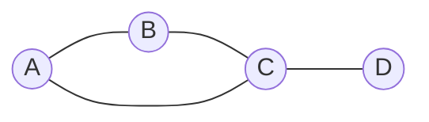
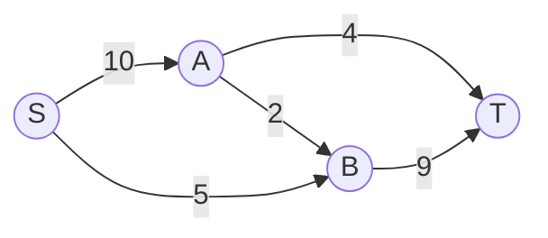
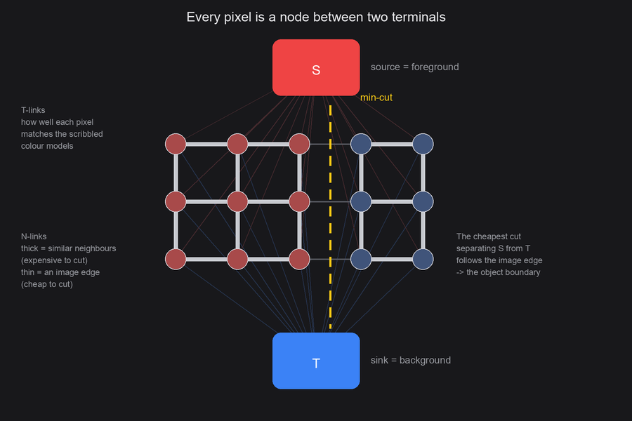
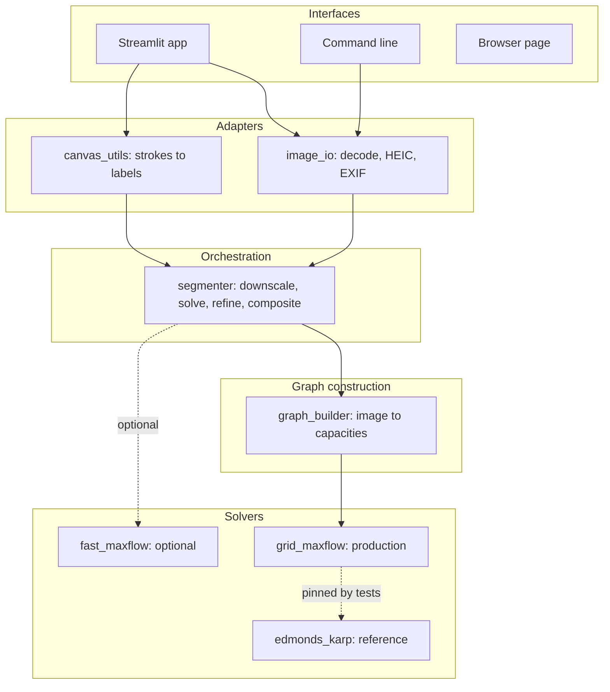
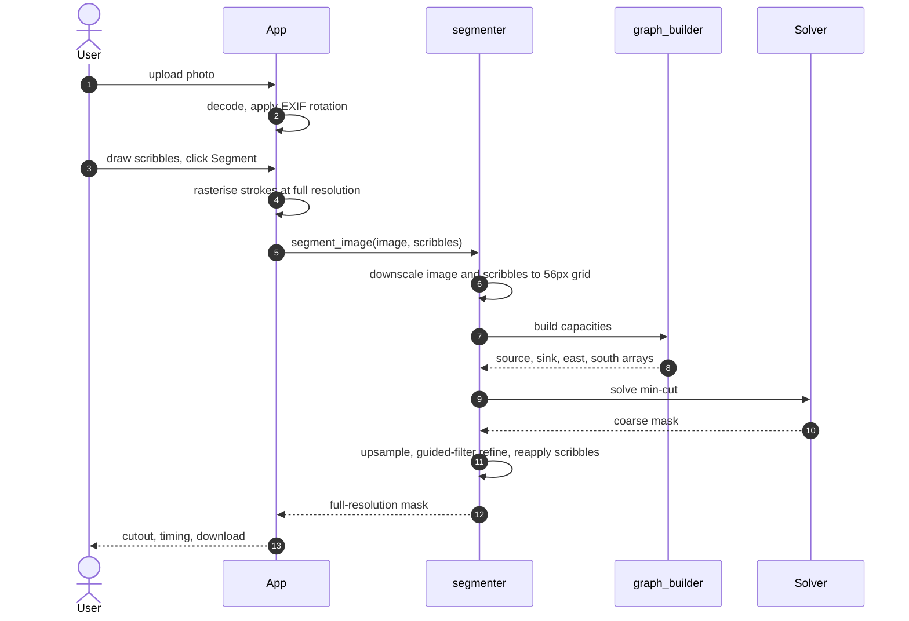
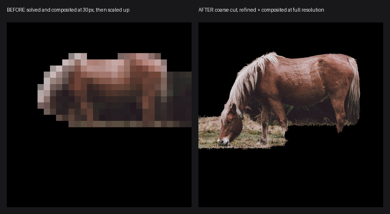

# The Complete Guide to mincut-segmentation

Everything about this project in one place, starting from the ideas it is built
on and ending with how every piece of it works.

No prior knowledge of graph theory or computer vision is assumed. If you know
what a pixel is and can read a little code, you can read this.

For quicker references: the [README](README.md) is the short version, the
[HLD](design/HLD.md) is the architecture, and the [LLD](design/LLD.md) is the
implementation detail.

---

## Contents

**Part 1: The problem**
- [1.1 What the project does](#11-what-the-project-does)
- [1.2 What image segmentation is](#12-what-image-segmentation-is)
- [1.3 Why it is harder than it looks](#13-why-it-is-harder-than-it-looks)

**Part 2: The concepts**
- [2.1 Graphs](#21-graphs)
- [2.2 Flow networks](#22-flow-networks)
- [2.3 Maximum flow](#23-maximum-flow)
- [2.4 Cuts and the minimum cut](#24-cuts-and-the-minimum-cut)
- [2.5 The max-flow min-cut theorem](#25-the-max-flow-min-cut-theorem)
- [2.6 Augmenting paths and Ford-Fulkerson](#26-augmenting-paths-and-ford-fulkerson)
- [2.7 Residual graphs, or why you must be able to undo](#27-residual-graphs-or-why-you-must-be-able-to-undo)
- [2.8 Edmonds-Karp](#28-edmonds-karp)

**Part 3: From a photo to a graph**
- [3.1 The key idea](#31-the-key-idea)
- [3.2 Pixels become nodes](#32-pixels-become-nodes)
- [3.3 N-links, the boundary term](#33-n-links-the-boundary-term)
- [3.4 T-links, the regional term](#34-t-links-the-regional-term)
- [3.5 Hard constraints](#35-hard-constraints)
- [3.6 A complete worked example](#36-a-complete-worked-example)

**Part 4: How the project is built**
- [4.1 Architecture](#41-architecture)
- [4.2 The modules](#42-the-modules)
- [4.3 The pipeline end to end](#43-the-pipeline-end-to-end)

**Part 5: The hard engineering problems**
- [5.1 Edmonds-Karp is too slow for photographs](#51-edmonds-karp-is-too-slow-for-photographs)
- [5.2 The grid solver](#52-the-grid-solver)
- [5.3 The blocky output problem](#53-the-blocky-output-problem)
- [5.4 The guided filter](#54-the-guided-filter)
- [5.5 The optional fast solver](#55-the-optional-fast-solver)
- [5.6 HEIC support](#56-heic-support)

**Part 6: Using it**
- [6.1 Install and run](#61-install-and-run)
- [6.2 The four ways to use it](#62-the-four-ways-to-use-it)

**Part 7: Testing, performance, limits**
- [7.1 How correctness is established](#71-how-correctness-is-established)
- [7.2 Performance](#72-performance)
- [7.3 Limitations](#73-limitations)

**Part 8: History and glossary**
- [8.1 How the project was built](#81-how-the-project-was-built)
- [8.2 Glossary](#82-glossary)

---

# Part 1: The problem

## 1.1 What the project does

You give it a photo. You scribble a red line over the thing you want to keep
and a blue line over the background. It works out the exact outline of the
object and hands back a cutout.


What makes it interesting is what is *not* involved. There is no neural
network, no training data, no model file. The whole thing is a graph algorithm
from 1972 applied to a problem from 2001, and it runs in about a second on a
laptop.

## 1.2 What image segmentation is

Segmentation means labelling every pixel in an image. In this project there
are exactly two labels: **foreground** (the thing you want) and **background**
(everything else).

If an image is 800 by 788 pixels, that is 630,400 pixels, and each needs a
yes or no. The output is a **mask**: a grid of true and false values the same
size as the image.

```
original photo          mask                 cutout
+-------------+     +-------------+     +-------------+
|   ~~~~~     |     |   #####     |     |   ~~~~~     |
|  ~horse~    |  -> |  #######    |  -> |  ~horse~    |
|   ~~~~~     |     |   #####     |     |   ~~~~~     |
|  grass      |     |             |     |  (black)    |
+-------------+     +-------------+     +-------------+
                     # = foreground
```

Once you have the mask, the cutout is easy: keep the pixels where the mask is
true, blank out the rest.

**So the entire problem is: how do you produce the mask?**

## 1.3 Why it is harder than it looks

A first instinct might be "keep the pixels that look like the ones the user
marked red". That fails badly:

- **Colour is ambiguous.** A brown horse against brown grass shares colours
  with its background. Judging pixels one at a time gives a speckled mess.
- **Objects are not one colour.** A horse has a light mane, a dark face and a
  brown body. Matching a single colour misses most of it.
- **Real boundaries are connected.** An object is a contiguous blob, not
  scattered pixels. Pixel-by-pixel decisions have no notion of that.

What you actually want is a decision that balances two competing pressures:

1. **Each pixel should get the label it individually resembles.**
2. **Neighbouring pixels should usually agree**, unless there is a visible edge
   between them, in which case disagreeing is fine.

That second pressure is what makes the result a clean connected shape instead
of noise. The trick this project uses is that **both pressures can be encoded
as costs in a graph**, and then a classical algorithm finds the cheapest
labelling exactly. Not approximately. Exactly.

To understand how, we need graphs.

---

# Part 2: The concepts

## 2.1 Graphs

A **graph** is dots joined by lines. The dots are **nodes** (or vertices), the
lines are **edges**.



Edges can carry a number, called a **weight**. What the weight means depends on
the problem: distance, cost, strength of connection, capacity.

That is genuinely all a graph is. The power comes from what you choose the
nodes and edges to represent.

## 2.2 Flow networks

A **flow network** is a graph where the weights mean **capacity**, and two
nodes are special:

- the **source**, written `S`, where everything comes from
- the **sink**, written `T`, where everything must go

Think of water pipes. Each edge is a pipe, and its capacity is the litres per
second that pipe can carry. Water enters at `S` and leaves at `T`.



Two rules govern any valid flow:

1. **Capacity.** No pipe carries more than its capacity.
2. **Conservation.** At every node except `S` and `T`, whatever flows in must
   flow out. Nothing accumulates and nothing appears from nowhere.

## 2.3 Maximum flow

The **maximum flow** is the largest total amount you can push from `S` to `T`
without breaking either rule.

In the network above, could we push 15? `S` can emit 10 + 5 = 15, so the source
side allows it. But look at where it has to arrive: `T` can only receive 4 + 9 =
13. So 15 is impossible.

Can we manage 13? We would need 4 through `A -> T` and 9 through `B -> T`. `B`
can only get 5 directly from `S`, so it needs 4 more via `A -> B`, but that pipe
only carries 2. So `B` can supply at most 5 + 2 = 7.

The real answer is 4 + 7 = **11**. Something is throttling the network, and
that something is the whole point of the next idea.

## 2.4 Cuts and the minimum cut

A **cut** splits the nodes into two groups: one containing `S`, the other
containing `T`. The **cost** of a cut is the total capacity of the edges going
from the `S` group to the `T` group.

Imagine taking a pair of scissors and snipping pipes until no water can get
from `S` to `T` at all. The cost is the total capacity you destroyed.

For the network above, try the cut `{S, A, B}` against `{T}`. The edges
crossing it are `A -> T` (4) and `B -> T` (9), so the cost is 13.

Try `{S}` against `{A, B, T}`. Crossing edges are `S -> A` (10) and `S -> B` (5),
cost 15.

Try `{S, A}` against `{B, T}`. Crossing edges are `A -> T` (4), `A -> B` (2) and
`S -> B` (5), cost **11**.

The **minimum cut** is the cheapest such split. Here it is 11.

## 2.5 The max-flow min-cut theorem

Notice that the maximum flow was 11 and the minimum cut is 11. That is not a
coincidence. It is a theorem, and it is the foundation of this entire project:

> **In any flow network, the maximum flow from `S` to `T` is exactly equal to
> the cost of the minimum cut separating `S` from `T`.**

The intuition is not hard. Every drop of water travelling from `S` to `T` has
to cross every cut at some point. So the flow can never exceed the capacity of
the narrowest cut. That is the easy half. The harder half, which the theorem
also guarantees, is that you can always achieve that bound.

**Why this matters here:** finding the minimum cut directly would mean checking
every possible way of splitting the nodes, and there are `2^n` of them. For a
modest 56 by 56 image that is 2^3136 possibilities, a number with about 944
digits. Utterly impossible.

But the theorem says you do not have to. Compute the maximum flow instead,
which is fast, and the minimum cut falls out of it for free.

**If you understand nothing else in this guide, understand this:** the project
wants a minimum cut, because the minimum cut will turn out to be the object's
outline. It computes a maximum flow instead, because that is tractable, and the
theorem guarantees they are the same thing.

## 2.6 Augmenting paths and Ford-Fulkerson

So how do you compute a maximum flow? The idea is almost naively simple:

```
start with zero flow everywhere
while you can still find a path from S to T with spare capacity:
    find the tightest pipe on that path
    push that much flow along the whole path
```

A path with spare capacity is called an **augmenting path**. The tightest pipe
on it is the **bottleneck**. This is the **Ford-Fulkerson method**.

Working through the earlier example:

| Step | Path found | Bottleneck | Running total |
| --- | --- | --- | --- |
| 1 | `S -> A -> T` | min(10, 4) = 4 | 4 |
| 2 | `S -> B -> T` | min(5, 9) = 5 | 9 |
| 3 | `S -> A -> B -> T` | min(6, 2, 4) = 2 | 11 |
| 4 | none left | | **11** |

Eleven, matching what we reasoned out by hand.

## 2.7 Residual graphs, or why you must be able to undo

There is a catch that makes Ford-Fulkerson actually work, and it is the part
people usually find surprising.

Suppose you greedily push flow down a path, and it turns out to have been a
poor choice that blocks a better routing. A simple algorithm would be stuck.
The fix is to allow flow to be **pushed back**.

Every time you send `f` units along an edge `u -> v`, you:

- reduce the remaining capacity of `u -> v` by `f`
- **increase** the capacity of a reverse edge `v -> u` by `f`

That reverse edge does not exist in the original network. It is bookkeeping,
and it means "you may cancel up to `f` units of what you previously sent".

The graph of remaining capacities, including these reverse edges, is the
**residual graph**. Ford-Fulkerson searches the residual graph, not the
original. That is what allows it to correct earlier decisions and guarantees it
reaches a true maximum rather than getting stuck at a merely decent answer.

In this project you can see it directly in
[`maxflow/edmonds_karp.py`](maxflow/edmonds_karp.py):

```python
residual[u][v] -= bottleneck   # less room going forward
residual[v][u] += bottleneck   # room created to undo
```

## 2.8 Edmonds-Karp

Ford-Fulkerson says "find an augmenting path" but never says *which one*. That
turns out to matter enormously. Pick badly and the algorithm can crawl.

**Edmonds-Karp** is Ford-Fulkerson with one rule added:

> Always choose the **shortest** augmenting path, counting edges.

Shortest-by-edge-count is exactly what a **breadth-first search** finds. BFS
explores outward in rings: everything one step from the source, then everything
two steps away, and so on. The first time it reaches the sink, it has arrived
by the fewest possible edges.

That single rule turns an algorithm with no useful bound into one that provably
finishes in `O(V · E²)` time, where `V` is nodes and `E` is edges.

This is the algorithm implemented from scratch here, and the pseudocode is
short enough to state in full:

```
edmonds_karp(graph, S, T):
    residual <- copy of graph, with reverse edges at capacity 0
    total    <- 0

    loop:
        path <- BFS through residual from S to T using edges with capacity > 0
        if no path exists: stop

        bottleneck <- smallest capacity along path

        for each edge (u, v) in path:
            residual[u][v] -= bottleneck
            residual[v][u] += bottleneck

        total <- total + bottleneck

    return total, residual
```

And once it stops, recovering the min-cut is almost trivial. Ask which nodes
are still reachable from `S` in the residual graph. Those are one side of the
cut, everything else is the other:

```
find_min_cut(graph, S, T):
    _, residual <- edmonds_karp(graph, S, T)
    reachable   <- BFS from S through residual
    return edges going from reachable to not-reachable
```

Why does that work? When the algorithm stops, no augmenting path remains, which
means the sink is not reachable. Every edge crossing from the reachable set to
the unreachable set must be completely saturated, otherwise you could have gone
further. Saturated edges crossing the boundary are precisely a cut whose cost
equals the flow. By the theorem, that makes it minimum.

---

# Part 3: From a photo to a graph

We now have a tool that finds the cheapest way to separate two things. Now we
make an image into a shape that tool can chew on. This construction is from
[Boykov and Jolly (2001)](https://www.csd.uwo.ca/~yboykov/Papers/iccv01.pdf).

## 3.1 The key idea

Build a graph where:

- **`S` represents "foreground"** and **`T` represents "background"**
- **every pixel is a node** sitting between them
- **edge costs are set so that the cheapest cut is the correct outline**

Then run max-flow. The min-cut that falls out separates the pixels attached to
`S` from those attached to `T`, which is your mask.

The entire craft is in choosing the edge weights.

## 3.2 Pixels become nodes



Each pixel gets two kinds of connection:

- **N-links** (neighbour links) to the pixels next to it
- **T-links** (terminal links) to `S` and to `T`

## 3.3 N-links, the boundary term

N-links join each pixel to its four neighbours (up, down, left, right) and
encode this rule: **neighbouring pixels should usually get the same label,
unless there is a visible edge between them.**

Cutting an N-link means putting a label boundary between two neighbours. So:

- **similar-looking neighbours get a high weight**, making it expensive to
  separate them
- **different-looking neighbours get a low weight**, making separation cheap

The formula:

```
weight(p, q) = k · exp( -β · (gray_p − gray_q)² )
```

Reading it piece by piece:

| Part | Meaning |
| --- | --- |
| `gray_p − gray_q` | how different the two pixels are in brightness |
| squared | direction does not matter, and large differences are punished harder |
| `exp(−β · ...)` | turns "difference" into "similarity", between 0 and 1 |
| `k` | overall scale, 50 in this project |
| `β` | how sensitive the falloff is |

When two pixels are identical the difference is 0, `exp(0) = 1`, and the weight
is the full `k`. As they diverge the weight decays toward 0.

**Where `β` comes from.** A fixed `β` would behave differently on a
high-contrast photo than on a flat one. Instead it is derived from the image
itself:

```
β = 1 / (2 · mean squared difference between all neighbouring pixels)
```

So "a big difference" is judged relative to how much variation that particular
photo already contains. A grey foggy scene and a punchy sunset both get
sensible weights. In the code this is `_estimate_beta`.

## 3.4 T-links, the regional term

T-links connect each pixel to both terminals and encode the other rule:
**each pixel should get the label it individually resembles.**

Resembles according to what? According to your scribbles. The project builds
two histograms of brightness:

- one from the pixels you marked **foreground**
- one from the pixels you marked **background**

A histogram is just a tally. Split the brightness range 0 to 255 into 32 bins
and count how many marked pixels fall into each. That gives, for any brightness
value, an estimate of how likely it is to be foreground or background.

The weights are then:

```
weight(S, p) = −log P(brightness of p | background)
weight(p, T) = −log P(brightness of p | foreground)
```

**The crossover is deliberate and confuses people, so it is worth slowing down.**

Cutting the edge `S -> p` is what assigns `p` to the *background*. So that edge
should be **cheap to cut when `p` really does look like background**. Since
`−log` of a large probability is small, a pixel that strongly matches the
background model gets a small `S -> p` weight, and is cheaply cut away from the
foreground. Exactly what we want.

**Why `−log`?** Two reasons. Probabilities multiply when you combine
independent pixels, and logarithms turn multiplication into addition, which is
what a graph cut sums up. And the negative sign flips it so that high
probability becomes low cost.

One practical detail: if a brightness bin has no marked pixels its probability
is 0, and `−log 0` is infinite. So every bin starts at a count of 1 rather than
0, which is called **Laplace smoothing**.

## 3.5 Hard constraints

If you scribbled on a pixel, you have told the algorithm the answer. That
should be final, not a suggestion.

So scribbled pixels do not get histogram weights. They get:

- foreground scribble: `S -> p` capacity `K`, and `p -> T` capacity 0
- background scribble: `S -> p` capacity 0, and `p -> T` capacity `K`

where `K` is chosen larger than the total N-link weight touching any single
pixel:

```
K = 1 + max over all pixels of (sum of N-link weights touching that pixel)
```

Why that value? Because it makes overriding you provably more expensive than
any alternative. To flip a pixel you marked, the cut would have to sever an
edge of cost `K`. Since `K` exceeds every possible combination of N-link cuts
around that pixel, doing so is never the cheapest option. Your input is
mathematically guaranteed to survive, not merely likely to.

## 3.6 A complete worked example

Here is the whole construction on an image small enough to print. The numbers
below are real output from the project's own code, not illustrations.

**The image** is 4 wide and 3 tall. Left half bright, right half dark:

```
grayscale values
  200  200   40   40
  200  200   40   40
  200  200   40   40
```

One foreground scribble at row 1 column 0, one background scribble at row 1
column 3.

**Step 1, estimate β:**

```
β = 0.00011068
```

**Step 2, N-links.** Weights to each pixel's right neighbour:

```
  50.000   2.941  50.000    -
  50.000   2.941  50.000    -
  50.000   2.941  50.000    -
```

Look at what happened. Inside the bright region and inside the dark region the
weight is the full 50, because those neighbours are identical. Across the
boundary between column 1 and column 2, where brightness jumps from 200 to 40,
the weight collapses to **2.941**.

**The algorithm has not been told where the edge is. The weights discovered it.**

Vertical N-links are all 50, since nothing changes going down.

**Step 3, the hard constraint:**

```
largest N-link total on any pixel = 152.94
K = 153.941
```

**Step 4, T-links.** Source capacities (`S -> pixel`):

```
    3.497    3.497    2.803    2.803
  153.941    3.497    2.803    0.000
    3.497    3.497    2.803    2.803
```

The scribbled foreground pixel has `K = 153.941`, exactly as designed.
Unmarked bright pixels get 3.497, unmarked dark pixels 2.803.

Sink capacities (`pixel -> T`) mirror it, with the background scribble holding
`K`.

**Step 5, run the solver:**

```
max flow = 36.856

resulting mask
  1  1  0  0
  1  1  0  0
  1  1  0  0
```

Bright half foreground, dark half background. Correct.

**Step 6, confirm the theorem.** Add up the capacity of every edge the cut
severs:

| Edges severed | Cost |
| --- | --- |
| The three weak N-links across the boundary | 8.822 |
| `S -> pixels` on the background side | 14.017 |
| `pixels -> T` on the foreground side | 14.017 |
| **Total cut cost** | **36.856** |

Which is the max flow, to three decimal places. The max-flow min-cut theorem,
demonstrated on real output.

And notice *why* the cut went where it did. Cutting the three weak N-links cost
8.822. Cutting three of the strong ones would have cost 150. The cheapest place
to separate the image was exactly along its visible edge, which is the whole
reason this construction works.

---

# Part 4: How the project is built

## 4.1 Architecture

Five layers, with dependencies pointing only downward. Nothing in the solver
knows a user interface exists.



## 4.2 The modules

| File | Job |
| --- | --- |
| [`image_io.py`](image_io.py) | Open any supported image, including HEIC, and apply EXIF rotation |
| [`canvas_utils.py`](canvas_utils.py) | Convert browser canvas strokes into a label mask |
| [`maxflow/graph_builder.py`](maxflow/graph_builder.py) | Build N-link and T-link capacities from an image and scribbles |
| [`maxflow/edmonds_karp.py`](maxflow/edmonds_karp.py) | The readable reference solver |
| [`maxflow/grid_maxflow.py`](maxflow/grid_maxflow.py) | The same algorithm made fast with numpy |
| [`maxflow/fast_maxflow.py`](maxflow/fast_maxflow.py) | Optional Boykov-Kolmogorov solver |
| [`segmentation/segmenter.py`](segmentation/segmenter.py) | The pipeline that ties it all together |
| [`segmentation/cli.py`](segmentation/cli.py) | Command-line interface |
| [`app.py`](app.py) | Streamlit user interface |
| [`web/segmentation.js`](web/segmentation.js) | The whole pipeline ported to JavaScript |

## 4.3 The pipeline end to end



Steps 6 through 9 are the only ones that run at reduced resolution. Everything
handed back to the user is full size.

---

# Part 5: The hard engineering problems

This is the part that separates a demo from a working tool.

## 5.1 Edmonds-Karp is too slow for photographs

`O(V · E²)` is a fine bound in theory and brutal in practice. Measured on a
real photo with the original dict-based solver:

| Grid | Pixels | Time |
| --- | --- | --- |
| 30 x 30 | 900 | 0.40s |
| 50 x 50 | 2,500 | 3.24s |
| 80 x 80 | 6,400 | 19.73s |
| 150 x 150 | 22,500 | about 27s |

A 12 megapixel phone photo has 12,000,000 pixels. This is not a tuning problem.
It is not going to happen.

The number of augmenting paths grows with pixel count, roughly two per pixel,
and each one costs a full breadth-first search. Profiling confirmed where the
time went: at an 80 by 80 grid, **3.37 seconds out of 3.43 was BFS**.

So the cut has to run on a small grid. The question becomes what that costs you,
and section 5.3 is about answering that properly.

## 5.2 The grid solver

The reference implementation stores the graph as nested dictionaries, which is
lovely to read and slow to run: every edge lookup is a dictionary probe.

[`grid_maxflow.py`](maxflow/grid_maxflow.py) runs the identical algorithm but
exploits the fact that a pixel grid is regular. Instead of a dictionary, the
residual capacities live in six numpy arrays, and each BFS level expands as a
handful of whole-array operations rather than a Python loop over edges.

There is also one genuinely neat optimisation. Every unmarked pixel is
connected to both terminals, so `S -> pixel -> T` is a valid augmenting path of
length two. Those are the shortest paths possible, so BFS finds them first, and
crucially **no two of them share an edge**. That means all of them can be
saturated in a single vectorised step instead of one search each:

```python
direct = np.minimum(residual.source, residual.sink)
residual.source -= direct
residual.sink -= direct
```

Result: about five times faster, which is what makes a 56 pixel grid affordable
instead of 30.

**The safety net.** Two implementations of one algorithm is a classic way to
introduce a subtle bug. So the fast one is pinned to the readable one by tests
that run both on randomised graphs and require the max-flow value and the
resulting mask to match **exactly**. Only the reference is checked against
hand-computed answers; everything else is checked against the reference.

## 5.3 The blocky output problem

This was the most instructive bug in the project.

Since the cut had to run on a small grid, the early version did the obvious
thing: shrink the image, segment it, composite the cutout, and scale the result
back up. The output looked like this:



The left panel is not a low-quality *photo*. It is the solver's 30 pixel working
grid, enlarged about 25 times. The user was being shown the algorithm's scratch
paper.

**The insight that fixed it:** the `O(V · E²)` constraint applies to the *cut*,
not to the *image*. Those are separable concerns:

- an object's **shape** is low-frequency information and survives downscaling
  perfectly well
- an object's **boundary precision** is exactly what needs full resolution

So the pipeline was split:

1. Solve the cut on the small grid, as before.
2. Upsample the resulting mask back to full resolution.
3. **Refine that boundary against the original full-resolution pixels.**
4. Apply the mask to the original image, which is never resampled.

Step 3 is the interesting one, and it is the next section. Step 4 means
foreground pixels come out bit-for-bit identical to the input, which there is a
test asserting.

The measured cost of full-resolution output turned out to be **about 0.01
seconds**, because the refinement is linear in pixel count while the solve is
quadratic. Essentially free.

## 5.4 The guided filter

Upsampling a coarse mask gives a blurry, blocky boundary in roughly the right
place. The job is to snap it onto the real edge.

A **guided filter** does exactly this. You give it two images:

- the **target**, here the blurry upsampled mask
- the **guide**, here the full-resolution photograph

It then fits, in every small window, a simple linear relationship:

```
target ≈ a · guide + b
```

and replaces each pixel with what that local fit predicts.

The consequence is what makes it useful. In a flat region of the guide there is
no structure to lock onto, so the fit just smooths. But where the guide has a
sharp edge, the fitted line follows that edge, and the output boundary jumps to
sit on it. The mask inherits the photograph's edges.

Concretely, this is what turns a staircase into a contour that follows
individual strands of a horse's mane, using a cut that never saw them.

It costs four box filters, which are `O(pixels)` regardless of window size.

## 5.5 The optional fast solver

Boykov-Kolmogorov is a max-flow algorithm designed specifically for the grid
graphs that appear in vision. It is available here as an opt-in, through the
PyMaxflow library.

Measured on identical graphs:

| Grid | Nodes | Edmonds-Karp | Boykov-Kolmogorov | Speed-up |
| --- | ---: | ---: | ---: | ---: |
| 56 x 56 | 3,136 | 0.87s | 0.001s | about 950x |
| 96 x 96 | 9,216 | 2.49s | 0.002s | about 1,376x |
| 69 x 96 | 6,624 | 9.70s | 0.005s | about 2,139x |

Roughly a thousandfold, with identical masks in every case compared.

**Why is it not the default, given that gap?** Because writing Edmonds-Karp
from scratch is the substance of this project. Swapping in a library solver
would delete the part worth showing. It stays available for when speed matters,
behind `fast=True`, and the benchmark script verifies both solvers agree
*before* it reports any timing, since a speed number is meaningless if the
answers differ.

## 5.6 HEIC support

iPhones save photos as HEIC, and Pillow cannot decode it, so those uploads were
rejected outright and had to be converted first.

The fix is the `pillow-heif` package, which registers a decoder into Pillow so
`.heic` opens like anything else. While adding it, one related bug came along
for free: phone cameras record image rotation as **metadata** rather than
rotating the actual pixels, so a photo taken sideways would have been segmented
sideways. Loading now applies that EXIF rotation.

**One limitation worth stating plainly.** This works in the app and CLI in any
browser, because Python decodes the file and the browser only ever receives a
PNG. It does **not** work on the hosted web page, where the browser must decode
the file itself, and only Safari can decode HEIC. The page says so explicitly
rather than pretending the file is broken.

---

# Part 6: Using it

## 6.1 Install and run

```bash
git clone https://github.com/singha105/mincut-segmentation.git
cd mincut-segmentation
python3 -m venv venv
source venv/bin/activate
pip install -r requirements.txt
streamlit run app.py
```

That opens the app at `http://localhost:8501`.

## 6.2 The four ways to use it

**The app.** Upload, choose red or blue, scribble, press Segment. Background can
be black, dimmed, or transparent, and the download is full resolution.

**The command line**, for scripting and batches:

```bash
python -m segmentation.cli photo.jpg out.png \
    --fg 350,300,250,20 --bg 60,40,340,20 --bg 100,740,500,20
```

**The Python API**, for embedding in something else:

```python
from segmentation.segmenter import cutout
from maxflow.graph_builder import FOREGROUND, BACKGROUND, UNMARKED

scribbles = np.full(image.shape[:2], UNMARKED, dtype=np.uint8)
scribbles[300:320, 350:600] = FOREGROUND
scribbles[40:60, 60:400] = BACKGROUND

result, mask = cutout(image, scribbles, background="transparent")
```

**The browser**, at
[singha105.github.io/mincut-segmentation](https://singha105.github.io/mincut-segmentation/),
which runs a JavaScript port of the same pipeline entirely client-side. Nothing
is uploaded anywhere.

---

# Part 7: Testing, performance, limits

## 7.1 How correctness is established

122 tests, but the number matters less than the structure, which is built on
**equivalence testing**.

The problem: how do you know a max-flow implementation is right? You cannot
eyeball a segmentation and tell whether the flow was truly maximal.

The approach used here:

1. **One implementation is verified by hand.** Small graphs where the answer was
   worked out on paper, including a case needing several augmenting-path
   iterations.
2. **Everything else is verified against that one.** The fast grid solver is
   pinned to the reference on randomised graphs and must match exactly, both
   the flow value and the mask. The Boykov-Kolmogorov solver is pinned the same
   way.

The payoff is that the fast paths can be optimised freely without weakening
the correctness argument, because any divergence fails a test immediately.

Other things that are pinned rather than assumed:

| Claim | How it is checked |
| --- | --- |
| Scribbled pixels are never overridden | Asserted after the refinement step |
| Output is the input's resolution | Shape assertion in the pipeline tests |
| Foreground pixels are untouched | Bit-for-bit array comparison |
| Both graph representations agree | Capacity-by-capacity comparison |
| Solvers do not mutate their inputs | Arrays compared before and after |
| The design docs are not stale | Signatures parsed out of the LLD and checked |

## 7.2 Performance

Best of 3 runs on Apple Silicon, 800 pixel inputs:

| Stage | Time |
| --- | --- |
| Graph construction | about 0.01s |
| The min-cut solve | 0.64s to 1.29s |
| Full-resolution refinement | about 0.01s |
| Compositing | negligible |
| **Total, worst case** | **1.29s** |

The solve is essentially the whole cost, which is why the grid is capped rather
than the output.

One counterintuitive detail: **end-to-end time barely changes with input
resolution.** A 400 pixel and an 800 pixel version of the same photo both reduce
to the same cut grid, so the solver does identical work. Only the refinement
scales with image size, and it is around 0.01s.

The cap is set by the *worst* image rather than the average, because the number
of augmenting paths depends on the content and not just the size. A dark hen on
dark soil needs far more paths than a horse against green trees, despite having
fewer grid nodes.

## 7.3 Limitations

Stated honestly, because knowing what a tool cannot do is part of knowing it.

**The colour model is grayscale only.** Brightness histograms, not colour. So
where a subject and its background share a tonal range, two scribbles are not
enough information and you need to add more. A tiger's shadowed stripes against
dark water is a real example from the project's own demo. Moving to colour
histograms or a Gaussian mixture is the single highest-value improvement
available.

**The cut is coarse.** 56 pixels on the longest side. The refinement recovers a
lot, but a genuinely intricate boundary such as hair or foliage is beyond it.
Fast mode allows a far finer grid if you need it.

**Binary only.** One foreground against one background. The two-terminal
construction does not extend to multiple labels without a different algorithm.

**HEIC does not work on the hosted page**, as covered in section 5.6.

**Two implementations to maintain.** Python and the JavaScript port must be
kept in step by hand. That is the price of a demo with no backend.

---

# Part 8: History and glossary

## 8.1 How the project was built

Eight phases, each one building on the last:

| Phase | What it added |
| --- | --- |
| 1 | Repository, packaging, CI, first tests |
| 2 | Edmonds-Karp from scratch, min-cut recovery, hand-verified tests |
| 3 | N-links, T-links, hard constraints, the segmentation pipeline |
| 4 | Streamlit app and the client-side browser version |
| 5 | Real photos, full-resolution output, the grid solver, benchmarks |
| 6 | Screenshots captured from the running app, demo GIF, diagram, README |
| 7 | Upload error handling, CLI, Makefile, CI matrix |
| 8 | Restructure into `web/`, dark theme, HEIC support |

## 8.2 Glossary

| Term | Meaning |
| --- | --- |
| **Augmenting path** | A route from source to sink that still has spare capacity |
| **Bottleneck** | The smallest capacity along a path, and so the most that path can carry |
| **BFS** | Breadth-first search, exploring outward in rings, which finds fewest-edge paths |
| **Capacity** | The most an edge can carry |
| **Cut** | A split of the nodes into a source side and a sink side |
| **Edge** | A connection between two nodes |
| **EXIF** | Photo metadata, including the rotation cameras record instead of rotating pixels |
| **Flow network** | A graph whose weights are capacities, with a designated source and sink |
| **Guided filter** | An edge-aware filter that reshapes one image using another as a guide |
| **Hard constraint** | A capacity so large the cut can never cross it, used to lock in user scribbles |
| **HEIC** | Apple's image format, which needs an extra decoder |
| **Laplace smoothing** | Starting every histogram bin at 1 so no probability is ever zero |
| **Mask** | A grid of true and false, one per pixel, saying which are foreground |
| **Max-flow** | The greatest amount that can be pushed from source to sink |
| **Min-cut** | The cheapest cut separating source from sink |
| **N-link** | An edge between neighbouring pixels, encoding "these should probably match" |
| **Node** | A point in a graph. Here, one pixel or one terminal |
| **Residual graph** | Remaining capacities, plus reverse edges that allow flow to be undone |
| **Sink** | The node everything flows to, here meaning background |
| **Source** | The node everything flows from, here meaning foreground |
| **T-link** | An edge from a pixel to a terminal, encoding "this pixel looks like that label" |

---

## Where to go next

- [README.md](README.md) for the short version
- [design/HLD.md](design/HLD.md) for the architecture
- [design/LLD.md](design/LLD.md) for interfaces and data structures
- [maxflow/edmonds_karp.py](maxflow/edmonds_karp.py) if you want to read the
  algorithm itself, which is about a hundred lines including its explanation
