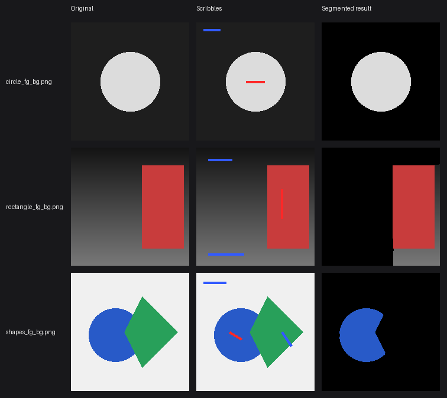

# mincut-segmentation

Built an interactive image segmentation tool using max-flow/min-cut graph algorithms, achieving segmentation on user-marked images in under 2s.

**Try it live:** [singha105.github.io/mincut-segmentation](https://singha105.github.io/mincut-segmentation/)
*(no install needed — see [Try it in your browser](#try-it-in-your-browser) below. The Python/Streamlit app in this repo is the original reference implementation; see [Setup](#setup) to run it locally.)*

## Demo

Actual output of `segment()` on each sample image — a couple of scribbled
pixels in, a foreground/background mask out:



## Real-world examples

The synthetic shapes above are the easy case — clean solid colors, sharp
edges. Real photos are a genuinely harder test: textured fur, uneven
lighting, and backgrounds that share colors with the subject. Here's the
same `segment()` function, unmodified, run on four real animal photos:


The horse comes out cleanly. The dog, hen, and tiger are only partially
captured — an honest result, not a cherry-picked one. This algorithm's
foreground/background model is a single grayscale intensity histogram per
region (see [How it works](#how-it-works-edmonds-karp-max-flow)), so when
the subject's fur tone overlaps with part of the background's tonal range
(a tiger's shadowed stripes vs. dark water, a dark hen vs. dark dirt), a
couple of scribbles won't fully disambiguate it. More scribbles in the
confused regions — exactly what the [interactive
tool](#try-it-in-your-browser) is for — would tighten these up.

Source photos are from Wikimedia Commons: [dog](https://commons.wikimedia.org/wiki/File:Dog_(Unsplash).jpg) (Multa Media, CC0), [hen](https://commons.wikimedia.org/wiki/File:American_Game_hen.jpg) (Jean Ogden, CC BY 2.0), [horse](https://commons.wikimedia.org/wiki/File:Horse_grazing_in_the_shade_of_conifers_(Unsplash).jpg) (Annie Spratt, CC0), [tiger](https://commons.wikimedia.org/wiki/File:Wet_tiger_(Unsplash).jpg) (佑翔 賴, CC0). Full-size copies are in [`sample_images/`](sample_images/).

## Try it in your browser

The [live page](https://singha105.github.io/mincut-segmentation/) is a fully
working version of the tool, no install required:

- **Upload** any image, not just the samples above
- **Scribble** red for foreground / blue for background, with an adjustable brush size
- **Segment** — runs the same Edmonds-Karp min-cut pipeline as a JavaScript
  port ([`docs/segmentation.js`](docs/segmentation.js)), entirely client-side
- **Download** the result as a PNG

There's no backend involved: image decoding, graph construction, and the
max-flow solve all happen in your browser via plain JavaScript.

## Setup

```bash
python3 -m venv venv
source venv/bin/activate
pip install -r requirements.txt
```

## Run

```bash
streamlit run app.py
```

## Test

```bash
pytest
```

## How it works: Edmonds-Karp max-flow

Segmentation is framed as a min-cut problem: pixels are nodes in a flow
network, with a source terminal representing "foreground" and a sink
terminal representing "background." The min-cut that separates source
from sink also separates the image into foreground and background
regions — so finding that cut is the core of the algorithm.

[`maxflow/edmonds_karp.py`](maxflow/edmonds_karp.py) computes it via
Edmonds-Karp, the BFS variant of Ford-Fulkerson:

1. **Residual graph.** Every edge `(u, v)` with capacity `c` gets a
   reverse edge `(v, u)`, initially capacity 0, so that flow pushed
   along `(u, v)` can later be partially undone if a better routing is
   found.
2. **Find an augmenting path.** BFS from source to sink using only edges
   with positive residual capacity. BFS always finds the *shortest*
   (fewest-edge) such path, which is what bounds the algorithm to
   `O(V * E^2)` instead of degrading on adversarial graphs.
3. **Push flow.** The path's bottleneck is its smallest residual
   capacity. Subtract that amount from each forward edge on the path and
   add it to each reverse edge.
4. **Repeat** until BFS can no longer find a path from source to sink —
   at that point the flow is maximum.
5. **Recover the cut.** The nodes still reachable from the source in the
   final residual graph form one side of the min-cut; the original edges
   crossing from that side to the rest of the graph are the cut edges,
   and by the max-flow min-cut theorem their capacities sum to the
   max-flow value.

See [`tests/test_maxflow.py`](tests/test_maxflow.py) for hand-verified
examples, including a case that requires multiple augmenting-path
iterations.

## Project layout

- `maxflow/` — Edmonds-Karp max-flow implementation and image-to-graph construction
- `segmentation/` — orchestration layer that turns a graph min-cut into a foreground/background mask
- `app.py` — Streamlit UI for marking foreground/background and viewing results
- `sample_images/` — synthetic shapes for manual testing, plus four real (CC0/CC-BY) animal photos for a harder real-world demo
- `tests/` — automated tests
- `docs/` — the [GitHub Pages site](https://singha105.github.io/mincut-segmentation/): `index.html`/`segmentation.js` (a client-side JS port with upload/scribble/segment/download) and `demo.png`/`demo_animals.png` (the static demo images)
