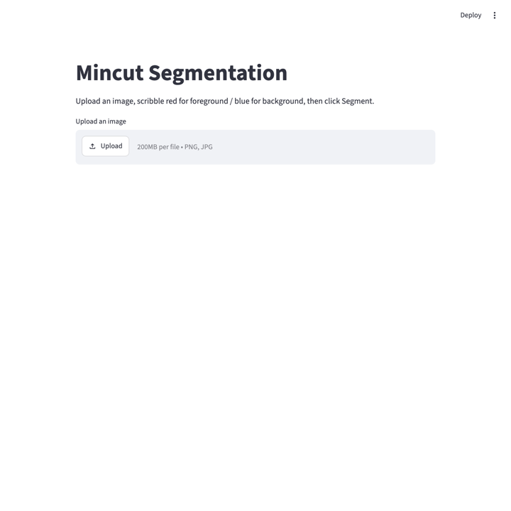
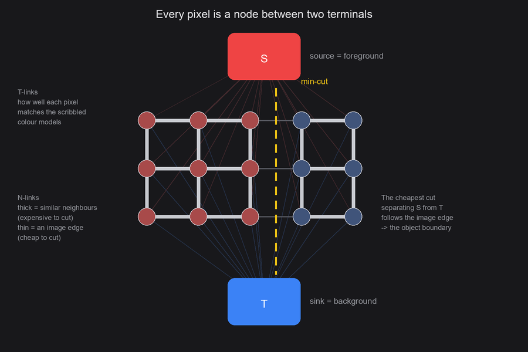
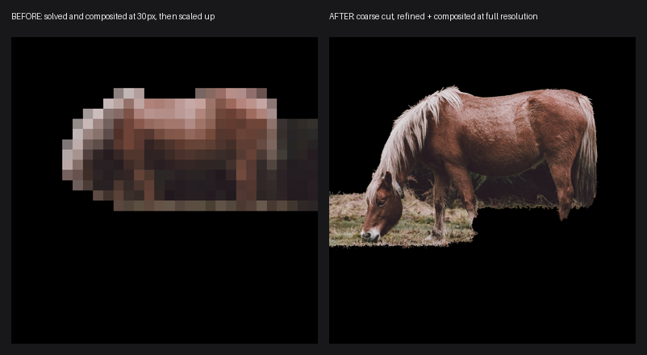
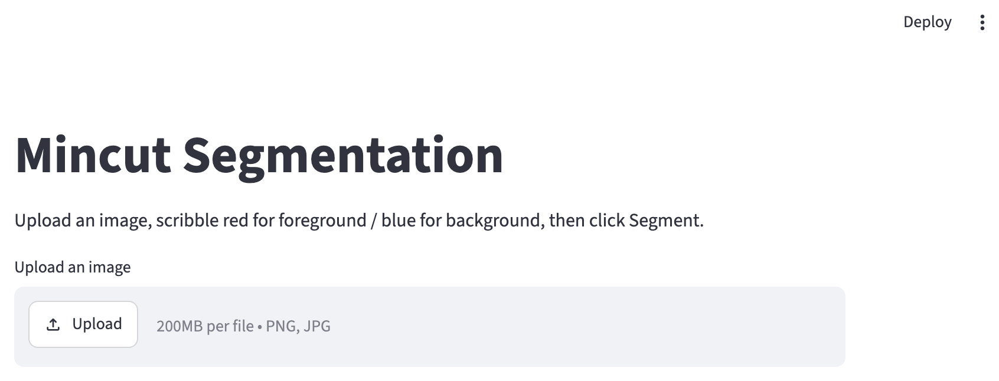
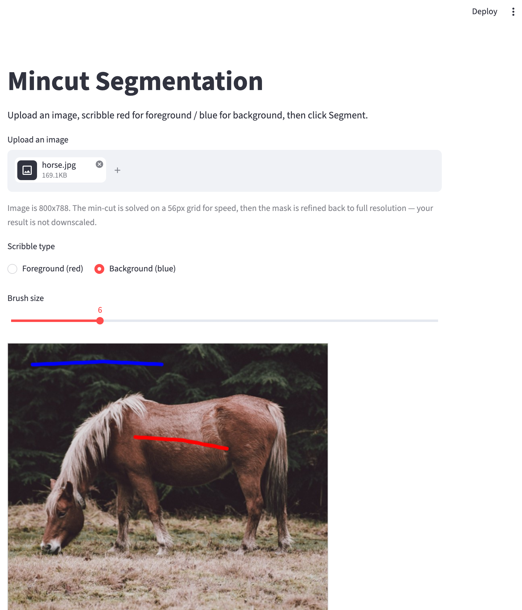
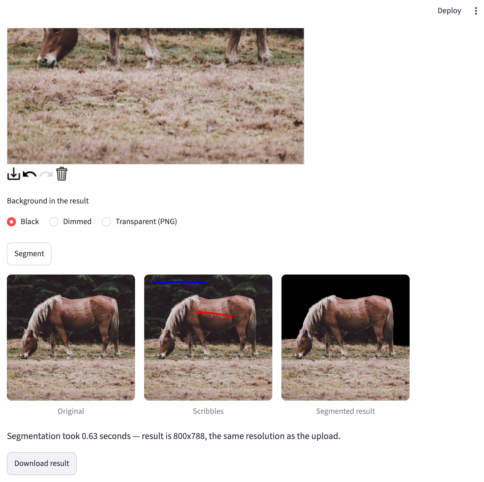
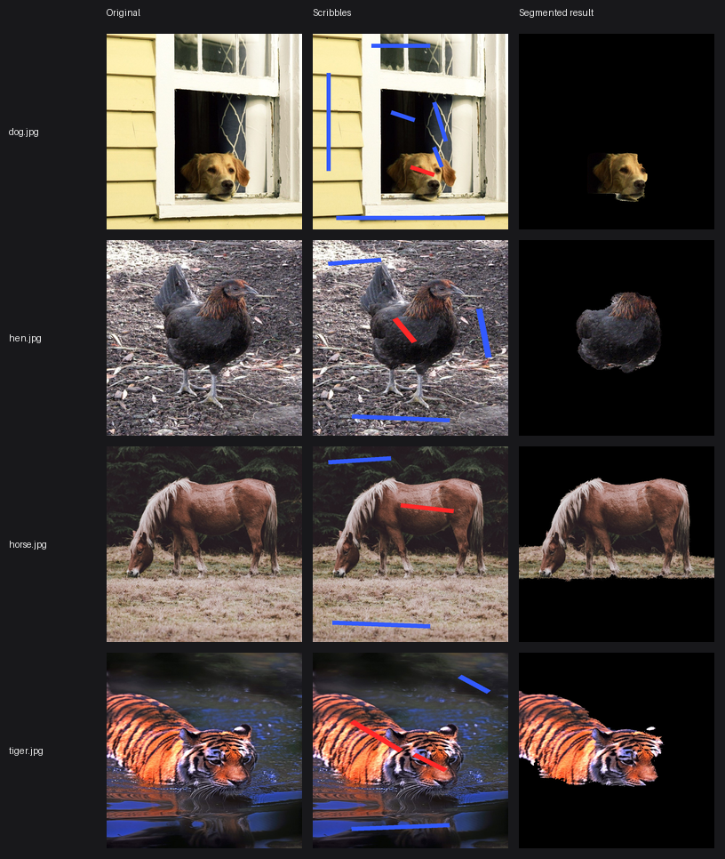

# mincut-segmentation

[](https://github.com/singha105/mincut-segmentation/actions/workflows/tests.yml)
[](https://www.python.org/)
[](LICENSE)

Built an interactive image segmentation tool using max-flow/min-cut graph algorithms, achieving segmentation on user-marked images in under 2s.



**[Try it live in your browser](https://singha105.github.io/mincut-segmentation/)** (nothing to install)

You scribble red over the thing you want to keep and blue over the stuff you
don't. From those few marked pixels it works out the whole boundary, and hands
back a cutout at the resolution you gave it. The max-flow solver underneath is
Edmonds-Karp, written from scratch rather than pulled from a library.

New here? **[GUIDE.md](GUIDE.md)** explains the whole thing from first
principles, assuming no graph theory, including a fully worked example with
real numbers.

## Contents

- [How it works](#how-it-works)
- [Screenshots](#screenshots)
- [Install and usage](#install-and-usage)
- [Performance](#performance)
- [Project structure](#project-structure)
- [The web page](#the-web-page)
- [Design documents](#design-documents)
- [Project phases](#project-phases)
- [Running the tests](#running-the-tests)
- [License](#license)

## How it works

Segmentation is set up as a **min-cut** problem, following the
[Boykov-Jolly](https://www.csd.uwo.ca/~yboykov/Papers/iccv01.pdf) formulation.
Every pixel becomes a node in a graph strung between two terminals: a **source**
`S` meaning foreground, and a **sink** `T` meaning background.



There are two kinds of edge.

**N-links** join each pixel to its four neighbours. The weight is high when the
two pixels look alike, low where their intensities differ:

```
weight(p, q) = k · exp( -β · (intensity_p − intensity_q)² )
```

So cutting through the middle of a smooth region is expensive, while cutting
along a real image edge is cheap. `β` comes from the image's own average
neighbour contrast, so the scale adapts per photo instead of being a magic
constant someone picked once.

**T-links** join every pixel to both terminals. For an unmarked pixel the
weights come from intensity histograms built out of your scribbles, so a pixel
that looks like the background is cheap to cut away from `S`, and the other way
round:

```
weight(S, p) = −log P(intensity_p | background)
weight(p, T) = −log P(intensity_p | foreground)
```

Pixels you actually scribbled on are a special case. They get a **hard
constraint** `K` on one side and `0` on the other, where `K` is bigger than any
pixel's total N-link weight. Relabelling a pixel you explicitly marked is then
always more expensive than cutting somewhere else, so your input never gets
overridden.

**Then the cut.** [Edmonds-Karp](maxflow/edmonds_karp.py) finds the maximum flow
from `S` to `T`:

1. **Residual graph.** Every edge `(u, v)` gets a reverse edge `(v, u)` at
   capacity 0, so flow pushed one way can be partly undone later.
2. **Find an augmenting path.** BFS from source to sink, using only edges with
   spare capacity. BFS always returns the shortest such path, and that is what
   bounds the algorithm to `O(V · E²)` instead of letting it fall apart on
   awkward graphs.
3. **Push flow.** Send the path's bottleneck capacity along it, updating both
   directions.
4. **Repeat** until there is no augmenting path left. The flow is now maximum.
5. **Read off the cut.** Whatever is still reachable from `S` in the residual
   graph is the foreground. By the max-flow min-cut theorem that partition is
   the cheapest one available, so it is the best boundary the evidence supports.

Since cutting is cheap along image edges and expensive everywhere else, the
optimal cut ends up hugging the object's outline.

### Two solvers, one algorithm

[`maxflow/edmonds_karp.py`](maxflow/edmonds_karp.py) is the readable version: a
nested-dict graph, walked one edge at a time. It is what the hand-verified tests
check against, but a dict lookup per edge makes it far too slow to actually
segment with.

[`maxflow/grid_maxflow.py`](maxflow/grid_maxflow.py) runs the same algorithm on
the 4-connected pixel grid, keeping residual capacities in numpy arrays so each
BFS level expands as a handful of whole-array operations. It also saturates
every `S → pixel → T` path in one vectorised step, since those are all shortest
paths and share no edges. Same asymptotics, much smaller constant.

The two have to agree exactly, and
[`tests/test_grid_maxflow.py`](tests/test_grid_maxflow.py) pins the fast one to
the reference on randomised graphs.

### Full-resolution output

The solve is `O(V · E²)`, so the cut runs on a small grid (56px on the longest
side). The **output is not downscaled**, though. The coarse mask gets upsampled
and pushed through a [guided filter](https://kaiminghe.github.io/eccv10/) using
the full-resolution image as the guide, which snaps the boundary back onto real
image edges, and the mask is then applied to the original pixels. Foreground
pixels come out bit-for-bit identical to what you put in.



Same photo, same scribbles, same algorithm in both panels. The only difference
is that the left one composited the cutout on the solver's 30px grid and scaled
it up, which is what this project used to do.

## Screenshots

| Upload | Scribble | Segment |
| --- | --- | --- |
|  |  |  |

These come from the running app rather than a mockup.
[`scripts/capture_screenshots.py`](scripts/capture_screenshots.py) drives it
headlessly with Playwright and regenerates them, GIF included.

### Results on real photos

`segment()` run on four Creative Commons animal photos, each at its own
resolution:



The dog and tiger each needed one extra scribble, and the reason is worth
knowing. The colour model is a single **grayscale** intensity histogram, so
where a subject and its background occupy the same tonal range (a tiger's
shadowed stripes against dark water, a dog's face against an unlit room) two
scribbles do not carry enough information to separate them. A colour model would
need fewer corrections.

Photos from Wikimedia Commons: [dog](https://commons.wikimedia.org/wiki/File:Dog_(Unsplash).jpg)
(Multa Media, CC0), [hen](https://commons.wikimedia.org/wiki/File:American_Game_hen.jpg)
(Jean Ogden, CC BY 2.0), [horse](https://commons.wikimedia.org/wiki/File:Horse_grazing_in_the_shade_of_conifers_(Unsplash).jpg)
(Annie Spratt, CC0), [tiger](https://commons.wikimedia.org/wiki/File:Wet_tiger_(Unsplash).jpg)
(佑翔 賴, CC0).

## Install and usage

```bash
git clone https://github.com/singha105/mincut-segmentation.git
cd mincut-segmentation
python3 -m venv venv
source venv/bin/activate          # Windows: venv\Scripts\activate
pip install -r requirements.txt
```

Then run the app. This is the only command you need:

```bash
streamlit run app.py
```

It opens at `http://localhost:8501`. Upload an image, pick **Foreground (red)**
or **Background (blue)**, scribble on the canvas, hit **Segment**. The background
can be rendered black, dimmed, or transparent, and the download comes out at
your image's original resolution.

**Formats:** PNG, JPEG, and **HEIC/HEIF**, so photos straight off an iPhone
work with no converting first. Pillow cannot decode HEIC by itself, so that
comes from [pillow-heif](https://github.com/bigcat88/pillow_heif), which is in
`requirements.txt`. EXIF rotation is applied on load as well, since phone
cameras record orientation in metadata instead of rotating the pixels, and
without that a photo shot sideways would be segmented sideways.

HEIC here works in **any browser, Chrome included**, because the browser never
decodes it. The file is uploaded as raw bytes, Python decodes it, and only PNG
comes back. That is not true of the hosted web page, where decoding is the
browser's job; see [The web page](#the-web-page).

### From the command line

No UI needed. Scribbles are given either as rectangles or as a red/blue scribble
image of the same shape:

```bash
python -m segmentation.cli sample_images/horse.jpg out.png \
    --fg 350,300,250,20 --bg 60,40,340,20 --bg 100,740,500,20
```

```
segmented 800x788 in 0.85s (24.3% foreground) -> out.png
```

`--fg` and `--bg` take `x,y,width,height` and can be repeated. There is also
`--scribbles strokes.png` to use a scribble image instead,
`--background black|dim|transparent`, `--mask out-mask.png` to dump the raw
mask, `--grid N` to change the cut resolution, and `--fast`. Run `--help` for
the full list.

### Using it as a library

```python
import numpy as np
from PIL import Image
from segmentation.segmenter import cutout
from maxflow.graph_builder import FOREGROUND, BACKGROUND, UNMARKED

image = np.array(Image.open("sample_images/horse.jpg").convert("RGB"))

scribbles = np.full(image.shape[:2], UNMARKED, dtype=np.uint8)
scribbles[300:320, 350:600] = FOREGROUND   # across the horse's back
scribbles[40:60, 60:400] = BACKGROUND      # the trees behind it
scribbles[740:760, 100:600] = BACKGROUND   # the grass in front

result, mask = cutout(image, scribbles, background="transparent")
Image.fromarray(result).save("out.png")
```

`segment_image(image, scribbles)` gives you just the boolean mask at full
resolution. `segment()` solves directly at whatever resolution you hand it.

### Optional extras

```bash
pip install -r requirements-fast.txt   # PyMaxflow, enables fast=True
pip install -r requirements-dev.txt    # Playwright + imageio, for regenerating screenshots
python -m playwright install chromium
```

### Make targets

Everything above is also a make target. Run `make` on its own to list them:

| Target | What it does |
| --- | --- |
| `make run` | launch the Streamlit app |
| `make test` | run the test suite |
| `make demo` | segment a sample photo via the CLI |
| `make bench` | measure end-to-end segmentation time |
| `make bench-solvers` | compare Edmonds-Karp against Boykov-Kolmogorov |
| `make screenshots` | recapture the screenshots and demo GIF |
| `make diagram` | regenerate the graph diagram above |
| `make install` / `install-fast` / `install-dev` | the three dependency sets |

## Performance

Measured with [`benchmarks/measure_timing.py`](benchmarks/measure_timing.py),
best of 3 runs on Apple Silicon. The **input** resolution is what you pass in
and get back; the cut grid is the internal working resolution.

| Input resolution | Megapixels | Cut grid | Nodes | Slowest photo |
| --- | ---: | ---: | ---: | ---: |
| 400px longest side | 0.11 to 0.16 | 40x56 to 56x56 | 2,072 to 3,136 | 1.16s |
| 600px longest side | 0.24 to 0.36 | 40x56 to 56x56 | 2,072 to 3,136 | 1.29s |
| 800px longest side | 0.43 to 0.64 | 40x56 to 56x56 | 2,072 to 3,136 | 1.22s |

End-to-end time is roughly flat in input resolution, because the cut runs on a
fixed-size grid and the other stages are cheap. Graph construction and the
full-resolution refinement are about 0.01s each. In practice that means
**full-resolution output is nearly free**, and the solve is the whole cost.

The 56px cap is set by the worst case rather than the average, because the
number of augmenting paths depends on the image and not just its size.
`hen.jpg` is a dark bird on dark soil, so foreground and background overlap
heavily in intensity, and it needs far more augmenting paths than the others.
It sets the ceiling: 2.5s at a 64px grid, 1.2s at 56px.

<details>
<summary><strong>Why 800px isn't slower than 600px</strong></summary>

<br>

Fair objection to that table: 800px reads as *faster* than 600px, which looks
backwards. It is not a typo, and it is not really a speed difference either.

Look at the "Cut grid" and "Nodes" columns, which are identical across all three
rows. Because the grid is capped on the longest side, a given photo reduces to
the same grid whatever you feed in. `hen.jpg` becomes 40x56 (2,240 nodes) from a
400px, 600px, or 800px input. **The solver does the same amount of work in every
row.** Input resolution only affects the refine-and-composite stages, which run
in about 0.01s.

What does change is the grid's *content*. Downscaling 800 to 56 and 600 to 56
are different reductions, so the resulting pixels differ slightly. Measured,
those two paths land within a mean absolute difference of 0.14 intensity levels
(max 1). Small shifts like that move the edge weights, which moves the
augmenting-path count.

The effect is tiny, and run-to-run spread on a fixed input is about 2% (10 runs
at 800px: min 1.157s, max 1.180s). So 600px and 800px sit within noise of each
other, and **differences under roughly 5% between rows are not meaningful.** The
one clear signal is `tiger.jpg`, whose downscaled content barely changes at all:
0.66s, 0.64s, 0.66s.

</details>

### Optional fast mode (Boykov-Kolmogorov)

Edmonds-Karp is the point of this project, so it stays the default. But
Boykov-Kolmogorov is the max-flow variant built for exactly these vision grid
graphs, and it is available opt-in through
[PyMaxflow](https://github.com/pmneila/PyMaxflow):

```bash
pip install -r requirements-fast.txt
```

```python
segment_image(image, scribbles, fast=True)
```

[`benchmarks/compare_solvers.py`](benchmarks/compare_solvers.py) runs both on
identical graphs and checks they agree *before* reporting any timing, since a
speed number would be meaningless if the answers differed. Results
([markdown](benchmarks/solver_comparison.md), [CSV](benchmarks/solver_comparison.csv)):

| Image | Cut grid | Nodes | Edmonds-Karp (from scratch) | Boykov-Kolmogorov (PyMaxflow) | Speed-up | Same result |
| --- | --- | ---: | ---: | ---: | ---: | :---: |
| dog.jpg | 56x56 | 3,136 | 0.87s | 0.001s | 952x | yes |
| hen.jpg | 40x56 | 2,240 | 1.20s | 0.001s | 1216x | yes |
| horse.jpg | 56x55 | 3,080 | 1.03s | 0.001s | 1220x | yes |
| tiger.jpg | 37x56 | 2,072 | 0.64s | 0.000s | 1348x | yes |
| dog.jpg | 96x96 | 9,216 | 2.49s | 0.002s | 1376x | yes |
| hen.jpg | 69x96 | 6,624 | 9.70s | 0.005s | 2139x | yes |
| horse.jpg | 96x95 | 9,120 | 2.70s | 0.002s | 1358x | yes |
| tiger.jpg | 64x96 | 6,144 | 4.12s | 0.002s | 1785x | yes |
| dog.jpg | 160x160 | 25,600 | not run | 0.007s | n/a | n/a |
| hen.jpg | 114x160 | 18,240 | not run | 0.013s | n/a | n/a |
| horse.jpg | 160x158 | 25,280 | not run | 0.006s | n/a | n/a |
| tiger.jpg | 106x160 | 16,960 | not run | 0.007s | n/a | n/a |

Roughly a **1000x to 2000x speed-up on the solve**, with identical masks in
every case compared. Past a 96px grid the from-scratch solver takes long enough
that timing every image is not worth the wall time, so those rows say "not run".

What that buys end to end:

| Mode | Cut grid cap | Slowest photo |
| --- | ---: | ---: |
| Edmonds-Karp (default) | 56px | 1.26s |
| Boykov-Kolmogorov | 56px | 0.01s |
| Boykov-Kolmogorov | 256px | 0.04s |
| Boykov-Kolmogorov | 400px | 0.08s |

So fast mode runs a **7x finer cut grid in about a fifteenth of the time**. That
is the real benefit: the cut itself lands much closer to full resolution, so it
leans less on the refinement pass to recover boundary detail.

> One gotcha. PyMaxflow's import name is `maxflow`, the same as this project's
> own package, so from the repo root ours shadows it.
> [`maxflow/fast_maxflow.py`](maxflow/fast_maxflow.py) loads it explicitly from
> site-packages to get around that.

## Project structure

```
mincut-segmentation/
├── app.py                       Streamlit UI (upload, scribble, segment, download)
├── canvas_utils.py              turns canvas strokes into a label mask
├── image_io.py                  image loading, HEIC/HEIF and EXIF rotation
├── Makefile                     run / test / bench / screenshots / demo targets
├── maxflow/
│   ├── graph_builder.py         image + scribbles into a Boykov-Jolly graph
│   ├── edmonds_karp.py          from-scratch reference solver (dict graph)
│   ├── grid_maxflow.py          same algorithm on numpy grid arrays (the fast path)
│   └── fast_maxflow.py          optional Boykov-Kolmogorov via PyMaxflow
├── segmentation/
│   ├── segmenter.py             coarse cut, full-res refinement, mask and compositing
│   └── cli.py                   command-line interface
├── web/                         the browser version (see below)
│   ├── index.html
│   └── segmentation.js          JS port of the whole pipeline
├── assets/                      images shared by the README and the web page
├── screenshots/                 captured app screenshots and demo GIF
├── tests/                       graphs, solver equivalence, pipeline, CLI, app
├── benchmarks/                  timing harness, solver comparison, saved results
├── GUIDE.md                     the complete explainer, concepts to implementation
├── design/                      HLD and LLD documents
├── scripts/                     screenshot capture, diagram and demo-image generators
└── sample_images/               synthetic shapes plus four CC-licensed animal photos
```

## The web page

[`web/`](web/) holds a standalone browser version, live at
**[singha105.github.io/mincut-segmentation](https://singha105.github.io/mincut-segmentation/)**.
It is only two files:

| File | What it is |
| --- | --- |
| [`web/index.html`](web/index.html) | the page itself, self-contained styling and markup |
| [`web/segmentation.js`](web/segmentation.js) | a JavaScript port of the whole pipeline |

[`segmentation.js`](web/segmentation.js) mirrors the Python function for
function: graph construction, the grid Edmonds-Karp solver, and the guided-filter
refinement. Everything runs client-side, so image decoding, the max-flow solve
and the full-resolution compositing all happen in your browser with no backend
at all. Uploaded images never leave your machine.

To work on it locally, serve the folder and open it:

```bash
python -m http.server 8000 --directory web
```

One thing the browser version cannot match: **HEIC**. Everything here runs
client-side, so decoding is up to the browser, and only Safari supports HEIC.
Chrome and Firefox refuse an iPhone photo, and the page says exactly that
rather than implying the file is broken.

To be clear about which is which:

| | HEIC in Chrome | HEIC in Safari |
| --- | :---: | :---: |
| Desktop app (`streamlit run app.py`) | works | works |
| Hosted web page | no | works |

The app works everywhere because Python decodes the file and the browser only
ever receives PNG. The hosted page has no server to lean on. Adding a
WebAssembly HEIC decoder to the page would close the gap, at the cost of a
1 to 2 MB download.

Another wrinkle: the page loads its images from `assets/`, which sits outside `web/`
so the README can share them. The
[Pages workflow](.github/workflows/pages.yml) copies both into the published
site. If you are serving `web/` directly and the demo images 404, that is why;
symlink or copy `assets/` into `web/` while you work.

## Design documents

Three documents, depending on what you want:

| Document | What it covers |
| --- | --- |
| [GUIDE.md](GUIDE.md) | The complete explainer: the concepts from scratch, the graph construction with a worked example, every engineering problem and how it was solved |
| [HLD.md](design/HLD.md) | Requirements, layered architecture, component responsibilities, data flow, deployment, technology choices, trade-offs, known limitations |
| [LLD.md](design/LLD.md) | Data structures, module interfaces, algorithm pseudocode, control-flow diagrams, invariants, error handling, complexity, test strategy |

Diagrams are Mermaid, so they render on GitHub and stay editable as text rather
than being flat images.

The signatures quoted in the LLD are parsed back out of the document and
checked against the code by
[`tests/test_design_docs.py`](tests/test_design_docs.py). Rename a documented
function and the suite fails, which keeps the documents from quietly going
stale.

## Project phases

How the project was built, in the order it happened.

- [x] **Phase 1: Project setup**
  - Repository, package layout, virtualenv and pinned requirements
  - GitHub Actions running the test suite on every push
  - MIT license, gitignore, first smoke tests

- [x] **Phase 2: Max-flow from scratch**
  - Edmonds-Karp with BFS-selected shortest augmenting paths
  - Min-cut recovery from the final residual graph
  - Hand-verified tests on small graphs with known answers, including a case
    needing several augmenting-path iterations

- [x] **Phase 3: Turning an image into a graph**
  - N-links between neighbouring pixels, weighted by colour similarity with
    `β` estimated from the image's own contrast
  - T-links from intensity histograms of the scribbles, plus hard constraints
    so marked pixels can never be relabelled
  - The pipeline joining graph construction to the solver, with an integration
    test on a real sample image

- [x] **Phase 4: Interactive app and browser version**
  - Streamlit UI: upload, drawable canvas, adjustable brush, timing, download
  - A GitHub Pages site running a JavaScript port of the whole pipeline
    client-side, with no backend

- [x] **Phase 5: Real photos, full-resolution output, performance**
  - Four Creative Commons animal photos as harder test cases
  - Output no longer inherits the solver's coarse grid. The mask is refined
    against the full-resolution image with a guided filter, so foreground
    pixels come back bit-for-bit identical
  - A second solver on numpy grid arrays, pinned to the reference for
    equivalence, plus a 56px cut grid to bring the worst case under 2s
  - Optional Boykov-Kolmogorov fast mode and a benchmark comparing the two

- [x] **Phase 6: Documentation and demo**
  - Real screenshots and a demo GIF captured by driving the app headlessly
    with Playwright
  - A generated diagram of the graph construction
  - Full README covering the algorithm, install, usage and benchmarks

- [x] **Phase 7: Robustness and tooling**
  - Unreadable and truncated uploads reported instead of crashing
  - A command-line interface for use without the UI
  - A Makefile for the common tasks
  - CI split into a matrix so the optional fast-mode tests actually run
    rather than always skipping

- [x] **Phase 8: Restructure and format support**
  - Web page moved into its own `web/` folder, published by a workflow that
    fails the build if the page references a missing file
  - App theme pinned to match the web page, so both look like one project
  - HEIC/HEIF uploads accepted directly, with EXIF rotation applied

## Running the tests

```bash
pytest
```

87 tests, covering:

- **Hand-verified max-flow.** Small graphs with known answers, including one
  that needs several augmenting-path iterations
  ([`test_maxflow.py`](tests/test_maxflow.py))
- **Solver equivalence.** The fast grid solver pinned to the reference on
  randomised graphs ([`test_grid_maxflow.py`](tests/test_grid_maxflow.py))
- **Graph construction.** N-link weighting, and that hard constraints really do
  dominate ([`test_graph_builder.py`](tests/test_graph_builder.py))
- **The pipeline.** Full-resolution masks, scribbles surviving refinement, and
  foreground pixels coming back bit-for-bit identical
  ([`test_segmentation.py`](tests/test_segmentation.py))
- **Fast mode.** Agreement with the reference, skipped when PyMaxflow is absent
  ([`test_fast_maxflow.py`](tests/test_fast_maxflow.py))
- **Scribble rasterising.** Canvas strokes into label masks
  ([`test_canvas_utils.py`](tests/test_canvas_utils.py))
- **The CLI.** Argument parsing, clipping, end-to-end output
  ([`test_cli.py`](tests/test_cli.py))
- **Image loading.** HEIC/HEIF decoding and EXIF rotation
  ([`test_image_io.py`](tests/test_image_io.py))
- **Design documents.** Signatures quoted in the LLD still exist in the code
  ([`test_design_docs.py`](tests/test_design_docs.py))
- **The app.** Bad uploads reported rather than crashing
  ([`test_app_upload.py`](tests/test_app_upload.py)), plus import and helper
  smoke tests ([`test_app_smoke.py`](tests/test_app_smoke.py))

CI runs the suite twice: once without PyMaxflow, where 77 pass and 10 skip,
which proves the project works without the optional dependency, and once with
it, where all 87 run.

To regenerate the screenshots and demo GIF:

```bash
pip install -r requirements-dev.txt
python -m playwright install chromium
python scripts/capture_screenshots.py
```

## Author

**Arnab Singh** — M.S. Computer Science, University of Dayton (Dec 2026).
Building toward DevOps, Cloud/AWS and Platform Engineering.

[GitHub profile](https://github.com/singha105) ·
[Portfolio](https://singha105.github.io) ·
[LinkedIn](https://www.linkedin.com/in/singharnab/) ·
[arnabsingh001@gmail.com](mailto:arnabsingh001@gmail.com)

## License

[MIT](LICENSE) © Arnab Singh

The sample photos are used under their own licenses (CC0 and CC BY 2.0),
credited under [Results on real photos](#results-on-real-photos).
