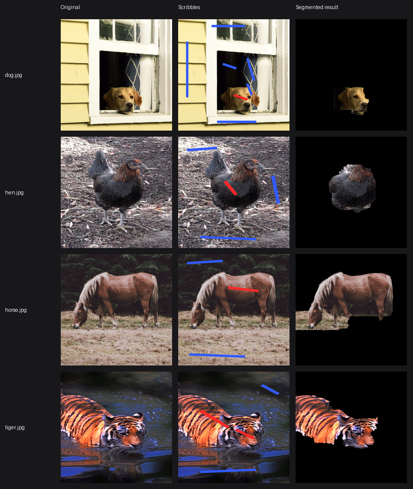

# mincut-segmentation

Built an interactive image segmentation tool using max-flow/min-cut graph algorithms, achieving segmentation on user-marked images in under 2s.


**[Try it live in your browser →](https://singha105.github.io/mincut-segmentation/)**
&nbsp;·&nbsp; no install needed

Scribble red over what you want to keep and blue over what you don't. A
max-flow/min-cut solve — Edmonds-Karp, written from scratch — turns those few
marked pixels into a full-resolution cutout.

---

## Contents

- [How it works](#how-it-works)
- [Screenshots](#screenshots)
- [Install & usage](#install--usage)
- [Performance](#performance)
- [Project structure](#project-structure)
- [Running the tests](#running-the-tests)
- [License](#license)

---

## How it works

Segmentation is posed as a **min-cut** problem, following the
[Boykov-Jolly](https://www.csd.uwo.ca/~yboykov/Papers/iccv01.pdf) formulation.
Every pixel becomes a node in a graph strung between two terminals: a **source**
`S` meaning *foreground*, and a **sink** `T` meaning *background*.


Two kinds of edge get built:

**N-links** connect each pixel to its 4 neighbours. The weight is high when the
two pixels look alike and low where their intensities differ:

```
weight(p, q) = k · exp( -β · (intensity_p − intensity_q)² )
```

So cutting *through* a smooth region is expensive, while cutting along a real
image edge is cheap. `β` is estimated from the image's own average neighbour
contrast, so the scale adapts per photo rather than being a magic constant.

**T-links** connect every pixel to both terminals. For an unmarked pixel, the
weights come from intensity histograms built from your scribbles — a pixel that
looks like the background is cheap to cut away from `S`, and vice versa:

```
weight(S, p) = −log P(intensity_p | background)
weight(p, T) = −log P(intensity_p | foreground)
```

Scribbled pixels are special-cased: they get a **hard constraint** `K` on one
side and `0` on the other, where `K` is larger than any pixel's total N-link
weight. That makes relabelling a pixel you explicitly marked always more
expensive than cutting elsewhere, so your input is never overridden.

**The cut.** [Edmonds-Karp](maxflow/edmonds_karp.py) then finds the maximum flow
from `S` to `T`:

1. **Residual graph** — every edge `(u, v)` gets a reverse edge `(v, u)` at
   capacity 0, so flow pushed one way can be partly undone later.
2. **Find an augmenting path** — BFS from source to sink using only edges with
   spare capacity. BFS always returns the *shortest* such path, which is what
   bounds the algorithm to `O(V · E²)` rather than letting it degrade on
   adversarial graphs.
3. **Push flow** — send the path's bottleneck capacity along it, updating both
   directions.
4. **Repeat** until no augmenting path remains. The flow is now maximum.
5. **Read off the cut** — whatever is still reachable from `S` in the residual
   graph is the foreground. By the max-flow min-cut theorem, that partition is
   the cheapest possible one, so it's the optimal boundary given the evidence.

Because cutting is cheap along image edges and expensive elsewhere, the optimal
cut naturally hugs the object's outline.

### Two solvers, one algorithm

[`maxflow/edmonds_karp.py`](maxflow/edmonds_karp.py) is the readable reference:
a nested-dict graph walked one edge at a time. It's what the hand-verified tests
exercise, but a dict probe per edge makes it too slow to segment with directly.

[`maxflow/grid_maxflow.py`](maxflow/grid_maxflow.py) runs the *same* algorithm
on the 4-connected pixel grid, holding residual capacities in numpy arrays so
each BFS level expands as a few whole-array operations. It also saturates every
`S → pixel → T` path in one vectorised step, since those are all shortest paths
and share no edges. Same asymptotics, far smaller constant.

The two must agree exactly, and
[`tests/test_grid_maxflow.py`](tests/test_grid_maxflow.py) pins the fast one to
the reference on randomised graphs.

### Full-resolution output

The solve is `O(V · E²)`, so the cut runs on a small grid (56px on the longest
side) — but the **output is not downscaled**. The coarse mask is upsampled and
pushed through a [guided filter](https://kaiminghe.github.io/eccv10/) using the
full-resolution image as the guide, which snaps the boundary back onto real
image edges, and the mask is then applied to the *original* pixels. Foreground
pixels come out bit-for-bit identical to the input.


Both panels use the same photo, the same scribbles and the same algorithm. The
only difference is that the left one composited the cutout on the solver's
30px grid and scaled it up, which is what earlier versions of this project did.

---

## Screenshots

| Upload | Scribble | Segment |
| --- | --- | --- |
|  |  |  |

These are captured from the running app, not mocked up —
[`scripts/capture_screenshots.py`](scripts/capture_screenshots.py) drives it
headlessly with Playwright and regenerates them, including the GIF at the top.

### Results on real photos

`segment()` run on four Creative Commons animal photos, each at its own
resolution:



The dog and tiger each needed one extra scribble, and the reason is worth
knowing: the colour model is a single **grayscale** intensity histogram, so
where a subject and its background share a tonal range — a tiger's shadowed
stripes against dark water, a dog's face against an unlit room — two scribbles
aren't enough to separate them. A colour model would need fewer corrections.

Photos from Wikimedia Commons: [dog](https://commons.wikimedia.org/wiki/File:Dog_(Unsplash).jpg)
(Multa Media, CC0), [hen](https://commons.wikimedia.org/wiki/File:American_Game_hen.jpg)
(Jean Ogden, CC BY 2.0), [horse](https://commons.wikimedia.org/wiki/File:Horse_grazing_in_the_shade_of_conifers_(Unsplash).jpg)
(Annie Spratt, CC0), [tiger](https://commons.wikimedia.org/wiki/File:Wet_tiger_(Unsplash).jpg)
(佑翔 賴, CC0).

---

## Install & usage

```bash
git clone https://github.com/singha105/mincut-segmentation.git
cd mincut-segmentation
python3 -m venv venv
source venv/bin/activate          # Windows: venv\Scripts\activate
pip install -r requirements.txt
```

Run the app — this is the single command you need:

```bash
streamlit run app.py
```

It opens at `http://localhost:8501`. Upload an image, pick **Foreground (red)**
or **Background (blue)**, scribble on the canvas, and click **Segment**. You can
render the background as black, dimmed, or transparent, and download the result
at your image's original resolution.

### Using it as a library

```python
import numpy as np
from PIL import Image
from segmentation.segmenter import cutout
from maxflow.graph_builder import FOREGROUND, BACKGROUND, UNMARKED

image = np.array(Image.open("sample_images/horse.jpg").convert("RGB"))

scribbles = np.full(image.shape[:2], UNMARKED, dtype=np.uint8)
scribbles[300:320, 350:600] = FOREGROUND   # across the horse's back
scribbles[40:60, 60:400] = BACKGROUND      # the trees behind it
scribbles[740:760, 100:600] = BACKGROUND   # the grass in front

result, mask = cutout(image, scribbles, background="transparent")
Image.fromarray(result).save("out.png")
```

`segment_image(image, scribbles)` returns just the boolean mask at full
resolution; `segment()` solves directly at whatever resolution you hand it.

### Optional extras

```bash
pip install -r requirements-fast.txt   # PyMaxflow, enables fast=True
pip install -r requirements-dev.txt    # Playwright + imageio, for regenerating screenshots
python -m playwright install chromium
```

---

## Performance

Measured with [`benchmarks/measure_timing.py`](benchmarks/measure_timing.py)
(best of 3 runs, Apple Silicon). The **input** resolution is what you pass in
and get back; the cut grid is the internal working resolution.

| Input resolution | Megapixels | Cut grid | Nodes | Slowest photo |
| --- | ---: | ---: | ---: | ---: |
| 400px longest side | 0.11 – 0.16 | 40x56 – 56x56 | 2,072 – 3,136 | 1.13s |
| 600px longest side | 0.24 – 0.36 | 40x56 – 56x56 | 2,072 – 3,136 | 1.23s |
| 800px longest side | 0.43 – 0.64 | 40x56 – 56x56 | 2,072 – 3,136 | 1.21s |

End-to-end time is roughly flat in input resolution, because the cut runs on a
fixed-size grid and the other stages are cheap — graph construction and the
full-resolution refinement are ~0.01s each. Practically, **full-resolution
output is nearly free**; the solve is the whole cost.

The 56px cap is set by the *worst* case rather than the average, because the
number of augmenting paths depends on the image, not just its size. `hen.jpg` —
a dark bird on dark soil, so foreground and background overlap heavily in
intensity — needs far more augmenting paths than the others and sets the ceiling
(2.5s at a 64px grid, 1.2s at 56px).

<details>
<summary><strong>Why 800px isn't slower than 600px</strong></summary>

<br>

The obvious objection to that table: 800px reads as *faster* than 600px, which
looks backwards. It isn't a typo, and it isn't really a speed difference either.

Look at the "Cut grid" and "Nodes" columns — identical across all three rows.
Because the grid is capped on the longest side, a given photo reduces to the
same grid whatever you feed in: `hen.jpg` becomes 40x56 (2,240 nodes) from a
400px, 600px, or 800px input. **The solver does the same amount of work in every
row.** Input resolution only affects the refine-and-composite stages, ~0.01s.

What does change is the grid's *content*. Downscaling 800→56 and 600→56 are
different reductions, so the resulting pixels differ slightly — measured, those
two paths land within a mean absolute difference of 0.14 intensity levels
(max 1). Those small shifts move the edge weights, which moves the
augmenting-path count.

That effect is tiny, and run-to-run spread on a fixed input is ~2% (10 runs at
800px: min 1.157s, max 1.180s). So 600px and 800px are within noise of each
other, and **differences under ~5% between rows aren't meaningful.** The one
clear signal is `tiger.jpg`, whose downscaled content barely changes: flat at
0.67s / 0.66s / 0.67s.

</details>

### Optional fast mode (Boykov-Kolmogorov)

Edmonds-Karp is the point of this project, so it stays the default. But
Boykov-Kolmogorov is the max-flow variant built for exactly these vision grid
graphs, and it's available opt-in via
[PyMaxflow](https://github.com/pmneila/PyMaxflow):

```bash
pip install -r requirements-fast.txt
```

```python
segment_image(image, scribbles, fast=True)
```

[`benchmarks/compare_solvers.py`](benchmarks/compare_solvers.py) runs both on
identical graphs and checks they agree *before* reporting any timing — a speed
number would be meaningless if the answers differed. Results
([markdown](benchmarks/solver_comparison.md), [CSV](benchmarks/solver_comparison.csv)):

| Image | Cut grid | Nodes | Edmonds-Karp (from scratch) | Boykov-Kolmogorov (PyMaxflow) | Speed-up | Same result |
| --- | --- | ---: | ---: | ---: | ---: | :---: |
| dog.jpg | 56x56 | 3,136 | 0.86s | 0.001s | 1116x | yes |
| hen.jpg | 40x56 | 2,240 | 1.27s | 0.001s | 1312x | yes |
| horse.jpg | 56x55 | 3,080 | 1.05s | 0.001s | 1028x | yes |
| tiger.jpg | 37x56 | 2,072 | 0.65s | 0.000s | 1332x | yes |
| dog.jpg | 96x96 | 9,216 | 2.53s | 0.002s | 1337x | yes |
| hen.jpg | 69x96 | 6,624 | 9.66s | 0.005s | 2038x | yes |
| horse.jpg | 96x95 | 9,120 | 2.72s | 0.002s | 1333x | yes |
| tiger.jpg | 64x96 | 6,144 | 4.12s | 0.002s | 1812x | yes |
| dog.jpg | 160x160 | 25,600 | not run | 0.007s | — | — |
| hen.jpg | 114x160 | 18,240 | not run | 0.013s | — | — |
| horse.jpg | 160x158 | 25,280 | not run | 0.007s | — | — |
| tiger.jpg | 106x160 | 16,960 | not run | 0.007s | — | — |

Roughly a **1000–2000× speed-up on the solve**, with identical masks in every
case compared. Above a 96px grid the from-scratch solver takes long enough that
timing every image isn't worth the wall time, so it's marked "not run".

What that buys end-to-end:

| Mode | Cut grid cap | Slowest photo |
| --- | ---: | ---: |
| Edmonds-Karp (default) | 56px | 1.23s |
| Boykov-Kolmogorov | 56px | 0.01s |
| Boykov-Kolmogorov | 256px | 0.05s |
| Boykov-Kolmogorov | 400px | 0.08s |

So fast mode runs a **7× finer cut grid in 1/15th the time** of the default —
which is the real benefit: the cut itself lands much closer to full resolution,
leaning less on the refinement pass to recover boundary detail.

> PyMaxflow's import name is `maxflow`, the same as this project's own package,
> so from the repo root ours shadows it.
> [`maxflow/fast_maxflow.py`](maxflow/fast_maxflow.py) loads it explicitly from
> site-packages to work around that.

---

## Project structure

```
mincut-segmentation/
├── app.py                       Streamlit UI (upload → scribble → segment → download)
├── canvas_utils.py              turns canvas strokes into a label mask
├── maxflow/
│   ├── graph_builder.py         image + scribbles → Boykov-Jolly graph
│   ├── edmonds_karp.py          from-scratch reference solver (dict graph)
│   ├── grid_maxflow.py          same algorithm, numpy grid arrays (the fast path)
│   └── fast_maxflow.py          optional Boykov-Kolmogorov via PyMaxflow
├── segmentation/
│   └── segmenter.py             coarse cut → full-res refinement → mask & compositing
├── tests/                       hand-verified graphs, solver equivalence, pipeline
├── benchmarks/                  timing harness, solver comparison, saved results
├── scripts/
│   ├── capture_screenshots.py   drives the app with Playwright for the screenshots/GIF
│   └── make_diagram.py          renders the graph diagram above
├── sample_images/               synthetic shapes + four CC-licensed animal photos
├── screenshots/                 captured app screenshots and demo GIF
└── docs/                        GitHub Pages site (a JS port of the same pipeline)
```

The [live page](https://singha105.github.io/mincut-segmentation/) runs a
JavaScript port of this exact pipeline
([`docs/segmentation.js`](docs/segmentation.js)) entirely client-side — image
decoding, graph construction, the max-flow solve, and the full-resolution
refinement all happen in the browser, with no backend.

---

## Running the tests

```bash
pytest
```

43 tests covering:

- **Hand-verified max-flow** — small graphs with known answers, including one
  needing multiple augmenting-path iterations
  ([`test_maxflow.py`](tests/test_maxflow.py))
- **Solver equivalence** — the fast grid solver pinned to the reference on
  randomised graphs ([`test_grid_maxflow.py`](tests/test_grid_maxflow.py))
- **Graph construction** — N-link weighting, and that hard constraints really do
  dominate ([`test_graph_builder.py`](tests/test_graph_builder.py))
- **The pipeline** — full-resolution masks, that scribbles survive refinement,
  and that foreground pixels are bit-for-bit the originals
  ([`test_segmentation.py`](tests/test_segmentation.py))
- **Fast mode** — agreement with the reference, skipped when PyMaxflow isn't
  installed ([`test_fast_maxflow.py`](tests/test_fast_maxflow.py))

CI runs on every push without PyMaxflow, so it reports 33 passed / 10 skipped;
with the optional extra installed all 43 run.

To regenerate the screenshots and demo GIF:

```bash
pip install -r requirements-dev.txt
python -m playwright install chromium
python scripts/capture_screenshots.py
```

---

## License

[MIT](LICENSE) © Arnab Singh

Sample photos are used under their own licenses (CC0 / CC BY 2.0), credited in
[Results on real photos](#results-on-real-photos).
