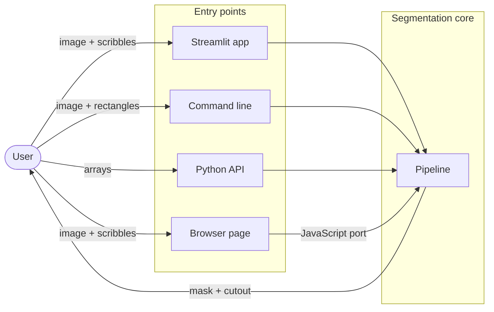
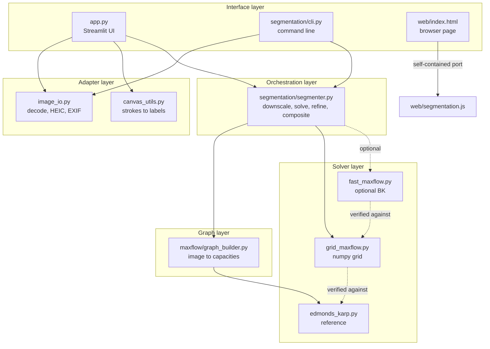
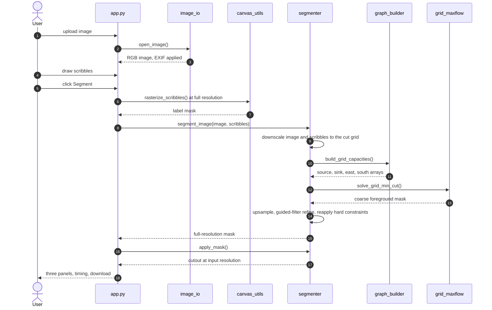
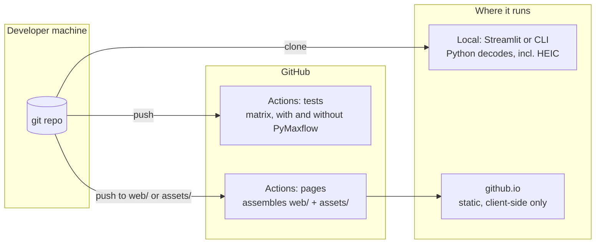

# High Level Design

System-level view of mincut-segmentation: what it is made of, how the pieces
fit together, and why they are arranged this way. For function signatures,
data structures and algorithm detail, see [LLD.md](LLD.md).

## Contents

- [1. Purpose and scope](#1-purpose-and-scope)
- [2. Requirements](#2-requirements)
- [3. System context](#3-system-context)
- [4. Architecture](#4-architecture)
- [5. Components](#5-components)
- [6. Data flow](#6-data-flow)
- [7. Deployment](#7-deployment)
- [8. Technology choices](#8-technology-choices)
- [9. Design decisions and trade-offs](#9-design-decisions-and-trade-offs)
- [10. Constraints and known limitations](#10-constraints-and-known-limitations)

## 1. Purpose and scope

Cut a foreground object out of a photograph from a handful of user strokes,
by solving the segmentation as a graph min-cut rather than with a trained
model.

In scope:

- Binary segmentation (one foreground region against everything else)
- Interactive marking through a UI, a CLI, a Python API, and a browser page
- Output at the input's own resolution

Out of scope:

- Multi-label segmentation, object recognition, anything learned from data
- Video, batch pipelines, multi-user services

## 2. Requirements

### Functional

| ID | Requirement |
| --- | --- |
| F1 | Accept an image, including HEIC/HEIF from Apple devices |
| F2 | Let the user mark foreground and background regions |
| F3 | Produce a binary foreground mask from those marks |
| F4 | Never relabel a pixel the user explicitly marked |
| F5 | Return a cutout with a black, dimmed or transparent background |
| F6 | Return output at the input's resolution |

### Non-functional

| ID | Requirement | How it is met |
| --- | --- | --- |
| N1 | Segment in under 2 seconds | Cut solved on a bounded grid, measured at 1.29s worst case |
| N2 | No loss of image fidelity | Mask applied to original pixels, verified bit-for-bit by test |
| N3 | Works with no server | Browser build ports the pipeline to JavaScript |
| N4 | Privacy: images do not leave the machine | Local app, or client-side page |
| N5 | Correctness is demonstrable | Solvers pinned to a hand-verified reference |
| N6 | Runs without optional dependencies | Fast solver is opt-in, tests skip when absent |

## 3. System context

Four entry points, one pipeline. The browser page runs a port of the same
pipeline rather than calling back to a server, so it has no dependency on the
Python side at runtime.

## 4. Architecture

Layered, with dependencies pointing downward only. Nothing in the solver layer
knows that a UI exists.

The dashed edges are the ones worth noticing. `grid_maxflow` and `fast_maxflow`
do not call the reference solver at runtime, but they are both pinned to it by
tests, which is what makes swapping them safe.

## 5. Components

| Component | Responsibility | Depends on |
| --- | --- | --- |
| `app.py` | Streamlit UI, session state, result rendering | `image_io`, `canvas_utils`, `segmenter` |
| `segmentation/cli.py` | Argument parsing, batch-friendly entry point | `image_io`, `segmenter` |
| `image_io.py` | Decode any supported format, register HEIF, apply EXIF rotation | Pillow, pillow-heif |
| `canvas_utils.py` | Turn fabric.js stroke objects into a label mask | Pillow, numpy |
| `segmentation/segmenter.py` | Downscale, solve, refine to full resolution, composite | `graph_builder`, solvers, OpenCV |
| `maxflow/graph_builder.py` | Build N-link and T-link capacities from image and scribbles | numpy |
| `maxflow/edmonds_karp.py` | Readable reference solver on a dict graph | none |
| `maxflow/grid_maxflow.py` | Same algorithm on numpy grid arrays, the production path | numpy |
| `maxflow/fast_maxflow.py` | Optional Boykov-Kolmogorov via PyMaxflow | PyMaxflow |
| `web/segmentation.js` | Client-side port of the whole pipeline | none |

## 6. Data flow

The important detail is where resolution changes. Only steps 8 to 11 work at
reduced resolution; the mask returned in step 13 and the cutout in step 15 are
at the input's own size.

## 7. Deployment

Two independent delivery paths. The local install is the full-capability one.
The hosted page is a static artifact with no server behind it, so it cannot do
anything requiring Python, HEIC decoding being the visible example.

## 8. Technology choices

| Choice | Why | Alternative considered |
| --- | --- | --- |
| Edmonds-Karp written by hand | The algorithm is the point of the project | A library solver, which would remove the substance |
| numpy for the production solver | Whole-array BFS levels instead of per-edge Python | Cython or C extension, more build friction |
| OpenCV for resize and box filter | Already a dependency, and its box filter makes the guided filter cheap | scipy, an extra dependency for two functions |
| Streamlit | Fastest route to an interactive canvas UI | Flask plus a hand-written frontend |
| Static JS port for the web | No server to run or pay for, and images stay on the user's machine | Hosting the Python app, which needs a backend |
| pillow-heif | The only practical way to decode HEIC in Pillow | Asking users to convert first, which was the original problem |
| PyMaxflow, optional | Boykov-Kolmogorov is far faster, but must not become mandatory | Making it required, which would compromise N6 |

## 9. Design decisions and trade-offs

**Solve coarse, output fine.** Edmonds-Karp cannot run per-pixel on a photo
(measured at about 27s for a 150x150 grid). Rather than downscale the *output*,
the cut runs on a small grid and the mask is refined back against the
full-resolution image. The trade-off is that boundary precision depends on the
refinement step rather than on the cut itself.

**Two solvers, one algorithm.** The readable dict-based solver stays in the
repository as the reference, and the fast numpy one is pinned to it by tests.
This keeps the code that explains the algorithm separate from the code that has
to be fast, without risking drift.

**Hard constraints over soft weights.** User strokes could have been strong
priors. Instead they get a capacity larger than any pixel's total N-link
weight, which makes overriding them provably impossible rather than merely
unlikely.

**Grayscale colour model.** A single intensity histogram per region. Simple and
fast, but it cannot separate a subject from a background that shares its tonal
range. This is the main accuracy limitation and is documented rather than
hidden.

**Port instead of API for the browser.** Duplicating the pipeline in JavaScript
means two implementations to keep in step, which is a real cost. It buys a demo
that needs no server, no cold starts, and no uploading of user images.

## 10. Constraints and known limitations

| Limitation | Cause | Mitigation |
| --- | --- | --- |
| Cut grid capped at 56px | Edmonds-Karp is `O(V·E²)` | Guided-filter refinement recovers boundary detail; fast mode allows a far finer grid |
| Subject and background sharing a tone may need extra strokes | Grayscale-only colour model | Documented, and more scribbles fix it |
| HEIC does not work on the hosted page | Only Safari decodes HEIC, and the page is client-side | The local app handles it in any browser |
| Two implementations of the pipeline | Python and the JavaScript port | Both mirror the same structure; the Python side is the reference |
| Binary segmentation only | Two-terminal graph construction | Out of scope by design |
