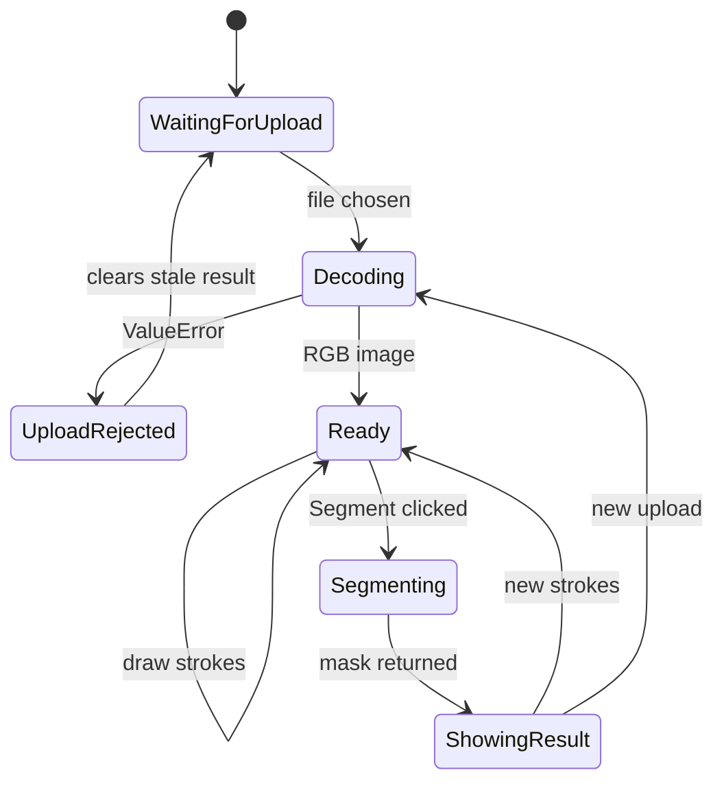
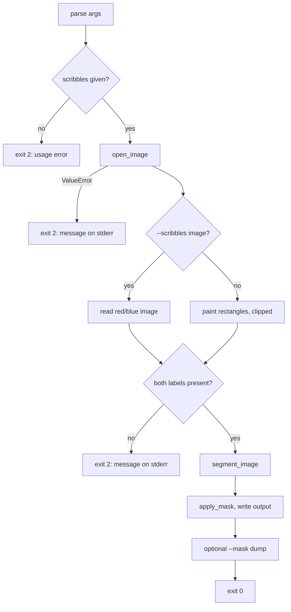

# Low Level Design

Module interfaces, data structures, algorithms and control flow. For the
system-level view see [HLD.md](HLD.md).

Signatures here are taken from the code and are kept in step with it by
[`tests/test_design_docs.py`](../tests/test_design_docs.py), which fails if a
documented function disappears or is renamed.

## Contents

- [1. Data structures](#1-data-structures)
- [2. Module interfaces](#2-module-interfaces)
- [3. Algorithms](#3-algorithms)
- [4. Control flow](#4-control-flow)
- [5. Invariants](#5-invariants)
- [6. Error handling](#6-error-handling)
- [7. Complexity](#7-complexity)
- [8. Test strategy](#8-test-strategy)

## 1. Data structures

### Label mask

`numpy.ndarray`, shape `(H, W)`, dtype `uint8`. One entry per pixel:

| Constant | Value | Meaning |
| --- | --- | --- |
| `UNMARKED` | 0 | the solver decides |
| `FOREGROUND` | 1 | user marked as foreground, hard constrained |
| `BACKGROUND` | 2 | user marked as background, hard constrained |

### Capacity arrays (production path)

The grid graph is four `(H, W)` `float64` arrays rather than an edge list.
Every pixel is implicitly a node at its own index:

| Array | Edge it holds |
| --- | --- |
| `source_capacity[y, x]` | `SOURCE -> (y, x)` |
| `sink_capacity[y, x]` | `(y, x) -> SINK` |
| `east_capacity[y, x]` | `(y, x) -> (y, x+1)`, last column zero |
| `south_capacity[y, x]` | `(y, x) -> (y+1, x)`, last row zero |

N-links are undirected, so `east` and `south` also seed the west and north
residuals inside the solver.

### Residual state

`_Residual` in `grid_maxflow.py` holds six arrays: `source`, `sink`, `east`,
`west`, `north`, `south`. Reverse edges are the mirrored entries, so the reverse
of `east[y, x]` is `west[y, x+1]` and the reverse of `south[y, x]` is
`north[y+1, x]`.

Reverse *terminal* edges are deliberately not stored. BFS starts at the source
and stops at the sink, so it never traverses `pixel -> SOURCE` or
`SINK -> pixel`, and at max flow the sink is unreachable anyway.

### Reference graph (documentation path)

`edmonds_karp.py` uses a nested dict, `{node: {neighbour: capacity}}`, with
nodes being `(y, x)` tuples plus the strings `"S"` and `"T"`. Readable, and far
too slow for real images, which is why it is kept only as the reference.

### BFS parent encoding

`grid_maxflow` records how each pixel was reached in an `int8` array, so the
augmenting path can be walked back without storing it:

| Constant | Value | Reached from |
| --- | --- | --- |
| `FROM_SOURCE` | 0 | the source terminal |
| `FROM_WEST` | 1 | `(y, x-1)` |
| `FROM_EAST` | 2 | `(y, x+1)` |
| `FROM_NORTH` | 3 | `(y-1, x)` |
| `FROM_SOUTH` | 4 | `(y+1, x)` |
| `UNREACHED` | -1 | not visited |

## 2. Module interfaces

### `image_io.py`

```python
UPLOAD_TYPES: list[str]                    # ["png", "jpg", "jpeg", "heic", "heif"]

register_heif() -> bool                    # register the HEIF decoder, idempotent
heif_available() -> bool                   # can HEIC be decoded in this environment
looks_like_heif(name) -> bool              # filename check, used for error messages
open_image(source, name=None) -> Image     # decode, apply EXIF rotation, convert to RGB
```

`open_image` raises `ValueError` with a readable message. It never lets a
Pillow decoder exception escape.

### `canvas_utils.py`

```python
rasterize_scribbles(objects, mask_shape, scale_x, scale_y) -> ndarray
```

`objects` are fabric.js path objects from the drawable canvas. Scale factors
map display coordinates onto the image's own resolution, so strokes lose no
precision on the way in.

### `maxflow/graph_builder.py`

```python
build_grid_capacities(image, scribble_mask, n_link_weight=50.0, num_bins=32)
    -> tuple[ndarray, ndarray, ndarray, ndarray]     # source, sink, east, south

build_graph(image, scribble_mask, n_link_weight=50.0, num_bins=32)
    -> dict                                          # reference dict graph
```

Both are built from the same private helpers, so the two representations cannot
drift apart:

```python
_to_grayscale(image)                       -> ndarray
_estimate_beta(gray)                       -> float
_n_link_capacities(gray, n_link_weight)    -> (east, south)
_neighbor_weight_sum(east, south)          -> ndarray
_t_link_capacities(gray, scribble_mask, hard_constraint, num_bins) -> (source, sink)
```

### `maxflow/edmonds_karp.py` (reference)

```python
edmonds_karp(graph, source, sink)          -> (max_flow, residual)
find_min_cut(graph, source, sink)          -> (min_cut_value, cut_edges)
find_reachable_from_source(residual, source) -> set
build_residual_graph(graph)                -> dict
bfs_find_augmenting_path(residual, source, sink) -> list | None
path_bottleneck(residual, path)            -> float
augment_along_path(residual, path, bottleneck) -> None
```

### `maxflow/grid_maxflow.py` (production)

```python
solve_grid_min_cut(source_capacity, sink_capacity, east_capacity, south_capacity)
    -> (max_flow: float, foreground_mask: ndarray[bool])
```

Does not mutate its inputs; capacities are copied into `_Residual` first.

### `maxflow/fast_maxflow.py` (optional)

```python
is_available() -> bool
solve_grid_min_cut_fast(source_capacity, sink_capacity, east_capacity, south_capacity)
    -> (max_flow: float, foreground_mask: ndarray[bool])
```

Same signature as `solve_grid_min_cut`, so the two are interchangeable. Raises
`ImportError` naming `requirements-fast.txt` when PyMaxflow is missing.

### `segmentation/segmenter.py`

```python
DEFAULT_PROCESSING_MAX_DIM = 56

segment(image, scribble_mask, n_link_weight=50.0, num_bins=32, fast=False) -> ndarray[bool]
segment_image(image, scribble_mask, processing_max_dim=56, n_link_weight=50.0,
              num_bins=32, fast=False) -> ndarray[bool]
apply_mask(image, mask, background="black", dim_factor=0.25) -> ndarray
cutout(image, scribble_mask, background="black", processing_max_dim=56)
    -> (cutout_image, mask)
```

`segment` solves at whatever resolution it is handed. `segment_image` is the
one to use on photographs: it solves coarse and returns a full-resolution mask.

## 3. Algorithms

### Graph construction

```
build_grid_capacities(image, scribbles):
    gray  <- luminance of image
    beta  <- 1 / (2 * mean squared difference between neighbours)

    east[y,x]  <- w * exp(-beta * (gray[y,x] - gray[y,x+1])^2)
    south[y,x] <- w * exp(-beta * (gray[y,x] - gray[y+1,x])^2)

    K <- 1 + max over pixels of total incident N-link weight

    fg_hist <- histogram of gray over FOREGROUND pixels, Laplace smoothed
    bg_hist <- histogram of gray over BACKGROUND pixels, Laplace smoothed

    for each pixel p:
        if p is FOREGROUND:  source[p], sink[p] <- K, 0
        elif p is BACKGROUND: source[p], sink[p] <- 0, K
        else:                 source[p], sink[p] <- -log bg_hist[bin(p)],
                                                    -log fg_hist[bin(p)]
    return source, sink, east, south
```

Laplace smoothing matters: an unsmoothed empty bin gives `P = 0` and `-log 0` is
infinite.

### Grid Edmonds-Karp

```
solve_grid_min_cut(source, sink, east, south):
    residual <- copy capacities, mirror east/south into west/north

    # every SOURCE -> p -> SINK path is shortest and edge-disjoint from the
    # others, so all of them are saturated in one vectorised step
    direct   <- minimum(residual.source, residual.sink)
    residual.source -= direct ; residual.sink -= direct
    max_flow <- sum(direct)

    loop:
        parent, sink_pixel <- BFS from all pixels with source capacity,
                              expanding one level at a time with whole-array ops
        if no sink_pixel: break
        path       <- walk parent back to the source
        bottleneck <- min capacity along the path
        push bottleneck, updating forward and reverse arrays
        max_flow  += bottleneck

    return max_flow, pixels still reachable from the source
```

The direct-path step is what makes the vectorised BFS worthwhile. Without it,
every unmarked pixel would need its own BFS for a path of length two.

### Full-resolution refinement

```
segment_image(image, scribbles, cap):
    if image already fits the cap: return segment(image, scribbles)

    small_image     <- INTER_AREA resize to the cut grid
    small_scribbles <- area-reduce each label, keep it wherever any pixel had it
    coarse_mask     <- segment(small_image, small_scribbles)

    soft    <- bilinear upsample of coarse_mask to full size
    guide   <- full-resolution grayscale, scaled to [0, 1]
    refined <- guided_filter(guide, soft, radius = upscale factor, eps = 1e-4)
    mask    <- refined >= 0.5

    mask[scribbles == FOREGROUND] <- True      # hard constraints still apply
    mask[scribbles == BACKGROUND] <- False
    return mask
```

Scribbles are reduced by area-averaging rather than nearest-neighbour sampling,
because a one-pixel-wide stroke would otherwise vanish at a 14x reduction.

### Guided filter

Fits `target ≈ a·guide + b` in every window and applies the per-pixel averages
of `a` and `b`. Where the guide has an edge the fit follows it, which is what
pulls the upsampled boundary onto real image edges. Implemented with four box
filters, so it costs `O(H·W)` regardless of radius.

## 4. Control flow

### Streamlit app



The result is held in `st.session_state` so a rerun (changing the background
option, for instance) does not resegment. The shape guard on the stored mask
prevents a result from a previous upload being shown against a new image.

### CLI



## 5. Invariants

| # | Invariant | Enforced by |
| --- | --- | --- |
| I1 | A scribbled pixel keeps its label in the output | `K > max incident N-link weight`, reapplied after refinement |
| I2 | `segment_image` returns a mask the same shape as the input | `test_segment_image_returns_a_full_resolution_mask` |
| I3 | Foreground pixels in a cutout are bit-for-bit the originals | `apply_mask` only writes to `~mask` |
| I4 | Grid and reference solvers agree exactly | `test_grid_maxflow.py` on randomised graphs |
| I5 | Fast and grid solvers agree exactly | `test_fast_maxflow.py` |
| I6 | Solvers do not mutate the capacities passed in | capacities copied into `_Residual`; asserted for fast mode |
| I7 | Both graph representations describe the same network | `test_grid_capacities_match_dict_graph` |

## 6. Error handling

| Condition | Where | Behaviour |
| --- | --- | --- |
| Unreadable or truncated file | `image_io.open_image` | `ValueError` with the underlying reason |
| HEIC without pillow-heif | `image_io.open_image` | `ValueError` naming what to install |
| Scribbles missing a label | `graph_builder._t_link_capacities` | `ValueError`, surfaced by the UI and CLI |
| Fast mode without PyMaxflow | `fast_maxflow` | `ImportError` naming `requirements-fast.txt` |
| Malformed CLI rectangle | `cli.rectangle` | `argparse.ArgumentTypeError` |
| Rectangles entirely off-image | `cli.main` | exit code 2 with an explanation |
| Stale result after a new upload | `app.py` | mask shape checked before rendering |

## 7. Complexity

Let `N` be the number of pixels on the cut grid and `P` the full-resolution
pixel count.

| Stage | Complexity | Measured |
| --- | --- | --- |
| Graph construction | `O(N)` | ~0.01s |
| Edmonds-Karp solve | `O(V·E²)`, about `2N` augmenting paths | 0.64s to 1.29s at 56px |
| Boykov-Kolmogorov solve | near linear in practice | about 0.001s at the same size |
| Guided-filter refinement | `O(P)`, box filters | ~0.01s |
| Compositing | `O(P)` | negligible |

The solve dominates completely, which is why the grid is capped rather than the
output. End-to-end time is close to flat in input resolution.

## 8. Test strategy

| Layer | File | What it pins down |
| --- | --- | --- |
| Algorithm | `test_maxflow.py` | Hand-computed max-flow values |
| Solver equivalence | `test_grid_maxflow.py` | Fast grid solver against the reference |
| Solver equivalence | `test_fast_maxflow.py` | Boykov-Kolmogorov against the grid solver |
| Graph construction | `test_graph_builder.py` | N-link weighting, hard-constraint dominance |
| Pipeline | `test_segmentation.py` | Full-resolution masks, pixel fidelity |
| Adapters | `test_image_io.py`, `test_canvas_utils.py` | HEIC, EXIF, stroke rasterising |
| Interfaces | `test_cli.py`, `test_app_upload.py`, `test_app_smoke.py` | Argument handling, bad uploads |
| Design docs | `test_design_docs.py` | Signatures named here still exist |

Equivalence testing is the backbone. Only one solver is verified against
hand-computed answers; the other two are verified against it, so the fast paths
can change freely without weakening the correctness argument.
